# Smartfarm Adaptive RAG

고추냉이 고설베드 온실의 재배 지식과 운영 관측을 연결하는 스마트팜 AI 운영 지원 시스템입니다. 재배 자료 상담, 카메라 확인, 센서 상태에 따른 답변 갱신을 업무별 경로로 나누어 처리하고, AI가 작성하는 설명과 설비를 움직이는 권한을 분리했습니다.


**대시보드 데모: https://namuori00.github.io/smartfarm-adaptive-rag/**
기록해 둔 운영 데이터와 AI 응답을 브라우저에서 재생합니다. 서버, AI 모델, 설비에는 연결되지 않으며 설치 없이 열립니다.

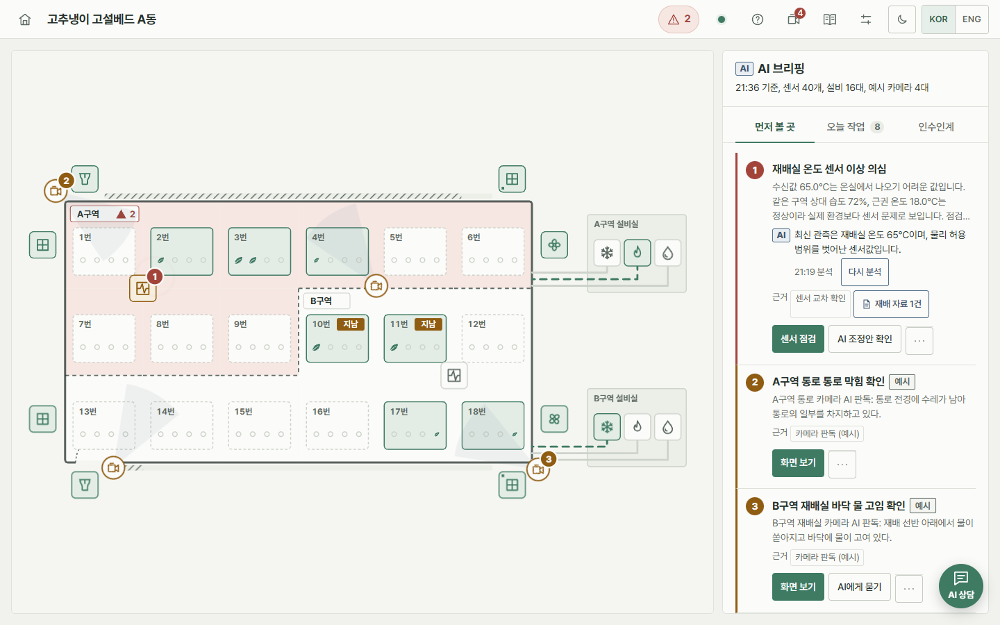

## 요약

| 항목 | 내용 |
|---|---|
| 개발 | 김유석(제주대학교 대학원 컴퓨터공학과 석사과정). 연구, 설계, 구현을 혼자 진행했습니다(2026.07–2026.10). |
| 운영 대상 | 펄라이트 고설베드 고추냉이 온실 시뮬레이터. 2개 구역, 베드 18개(각 4단), 관측 항목 40개, 설비 16대, 예시 카메라 4대 |
| 연구 | ① 질의 적응형 검색 채널 제어: KCI 등재지 게재(제1저자) ② 근거 조건부 응답·기권: IEEE Access 심사 중(제1저자) ③ 센서 변화 기반 선택적 답변 수정: 석사학위논문 신규 연구 |
| 주요 결과 | ① 공개 검색 벤치마크 3종에서 nDCG@10이 고정 프로파일 적응 융합보다 0.023–0.087 높음(유의) ② 다시점 관제 영상에서 정답 공개율이 기권 프롬프트보다 41.2%p 높고, 선택된 가용 시점 260개에서 오답 공개 0건 ③ 전체 재생성과 같은 응답–상태 일치(110/110)를 유지하면서 생성 답변 단위 26.5% 감소 |
| 구현 | 검색 코어와 승인형 설비 제어 서비스(MCP), 온실 텔레메트리 시뮬레이터(Python, FastAPI), 디지털 트윈 형태의 운영 대시보드(React, Three.js). 테스트 572개(Python 254, 웹 318) |
| 저장소 | `main`: 모듈, 구조, 배포 구성 · [`demo`](https://github.com/NAMUORI00/smartfarm-adaptive-rag/tree/demo): 대시보드 기록과 GitHub Pages 배포 · 영상 연구 코드: [multiview-selective-vqa](https://github.com/NAMUORI00/multiview-selective-vqa) |

## 화면 구성

대시보드는 온실 전체를 그린 배치도에서 시작해, 베드나 설비를 누르면 그 대상 하나를 3D로 보여 주고 오른쪽 패널에서 관측, 설비 조절, 재배 기록, AI 상담을 이어 가는 구조입니다. 화면은 한국어와 영어, 밝은 테마와 어두운 테마, 휴대폰 폭을 지원합니다.

| 화면 | 구성 |
|---|---|
|  | **온실 배치도와 AI 브리핑**<br>두 구역의 베드 18개를 위에서 본 그림입니다. 단마다 작물을 표시하고 설비실, 배관, 카메라 위치를 함께 그립니다. AI 브리핑은 센서, 설비 보고, 카메라 판독, 재배 기록을 함께 읽어 먼저 볼 곳을 순서대로 고르고, 배치도의 같은 자리에 번호를 찍습니다. 오늘 작업 동선과 인수인계도 같은 패널에서 봅니다. |
| 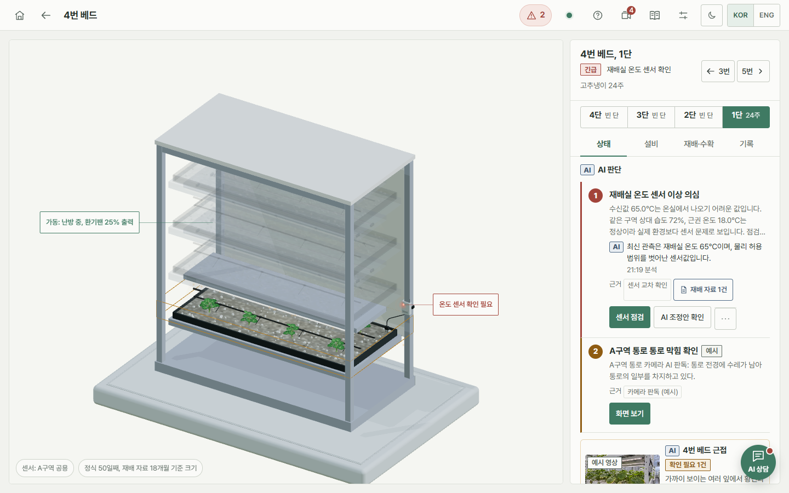 | **베드 3D (디지털 트윈)**<br>고른 베드 하나를 3D로 보입니다. 단을 고르면 그 단으로 확대하고, 작물 크기는 정식 후 경과일과 수확 예정일 또는 재배 자료의 재배 기간으로 그립니다. 센서 상태등, 배지 수분, 조명, 경보 위치를 모형 위에 표시하고, 센서가 구역 공용이라는 점을 함께 밝힙니다. |
| 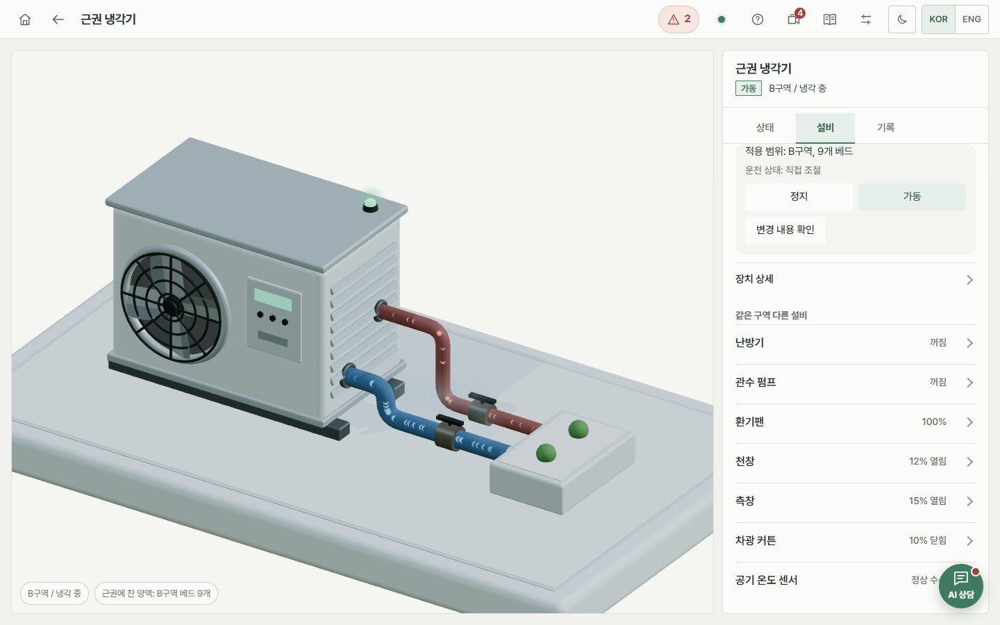 | **설비 3D와 조절 카드**<br>냉각기, 난방기, 관수 펌프, 환기팬, 천창, 측창, 차광막을 각각 모형으로 만들어 장치 보고값대로 움직입니다(냉매 흐름, 팬 회전, 개도). 적용 범위(예: B구역 베드 9개)를 보이고, 변경 내용 확인 → 허용 → 장치 응답 → 회복 확인을 한 카드에서 진행합니다. |
| 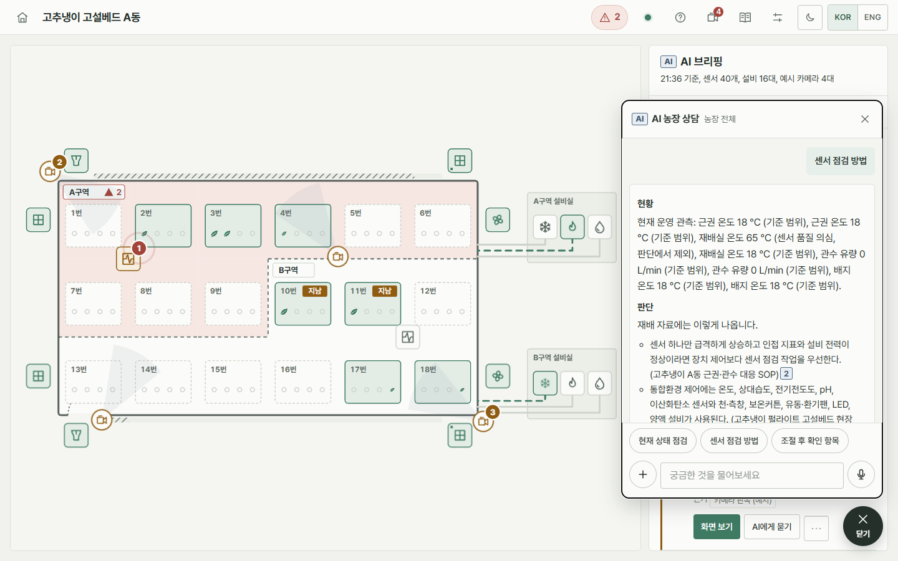 | **AI 농장 상담**<br>고른 베드나 구역의 관측을 함께 읽어 답하고, 문장 끝에 출처 번호를 붙입니다. 관측 근거는 구역별 표로, 답이 만들어진 과정(검색 방법별 비중과 후보 수)은 펼쳐서 봅니다. 센서 값이 바뀌면 답의 해당 부분만 다시 확인합니다. |
| 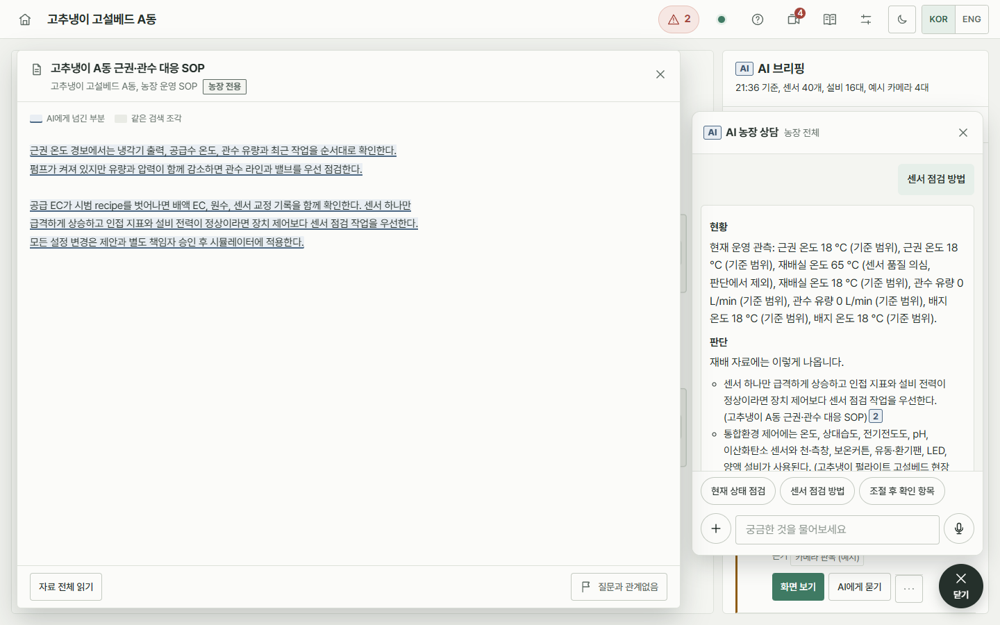 | **근거 원문 읽기**<br>출처 번호를 누르면 원문을 열고 AI에게 넘긴 부분을 표시합니다. 운영 환경에서는 PDF, 웹 페이지 보관본, Word 원본 위에 직접 표시하고, 공개 데모에서는 저작권 때문에 답변이 인용한 쪽의 추출문만 싣습니다. |
| 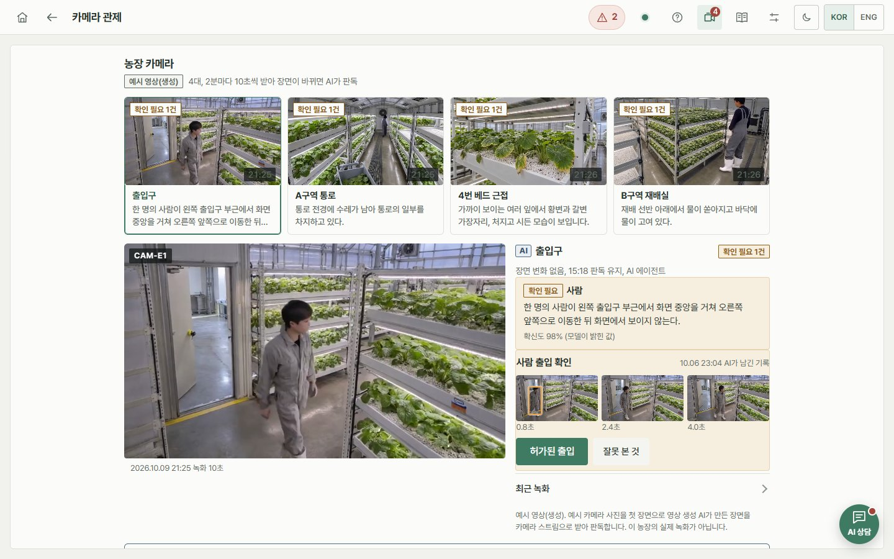 | **카메라 관제**<br>카메라 영상을 주기적으로 받아 장면이 바뀌었을 때만 AI가 판독합니다(사람 출입, 통로 막힘, 바닥 물 고임, 잎 변색). 확인이 필요한 장면은 근거 화면과 함께 기록으로 남고, 사람이 확인해 닫습니다. 데모 영상은 예시 사진을 첫 장면으로 영상 생성 모델이 만든 장면입니다. |
| 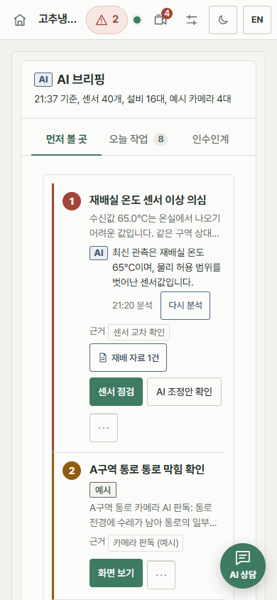 | **휴대폰 화면**<br>같은 기능을 한 열로 배치합니다. 배치도는 구역별 목록으로 바뀌고, 상담 창은 전체 화면으로 열립니다. |

## 연구 배경

스마트팜은 센서로 재배 환경을 관측하고, 수집한 정보에 따라 관리 조치를 결정하는 데이터 기반 운영 체계입니다[1]. 온도, 습도, 전기전도도(EC), pH 같은 측정값만으로는 변화의 원인과 대응을 판단하기 어렵기 때문에, 운영자는 재배 지침, 생육 단계, 설비 상태, 작업 이력을 함께 검토해야 합니다. 검색 증강 생성(RAG)은 외부 문서를 검색해 답변의 근거로 제공하는 방식이며[2], 농업 분야에서도 재배 관리 지침 제시[3], 센서와 기상 정보를 결합한 관개 추천[4], 상담과 관측 기반 제어의 연결[5]이 연구되었습니다.

운영 판단에 쓰는 정보는 세 가지 조건을 만족해야 합니다. 냉각 조치를 검토할 때는 재배 조건에 맞는 문서를 찾아야 하고(**적합성**), 영상으로 설비 주변을 확인할 때는 질문에 답할 근거가 화면 안에 있어야 하며(**충분성**), 답변을 작성하는 동안 온도가 정상 범위로 돌아왔다면 기존 권고의 전제가 달라집니다(**최신성**)[6]–[8]. 문서 상담, 영상 확인, 상태 기반 답변은 필요한 근거와 판단 시점이 서로 다르지만, 운영자는 같은 구역과 설비의 관측과 작업 이력을 바탕으로 이를 이어서 사용합니다. 이 시스템은 각 업무에 맞는 근거를 고르는 방법과 바뀐 상태를 반영하는 방법을 하나의 운영 지원 구조 안에서 연결합니다.

## 관련 연구

| 영역 | 기존 접근 | 운영 지원에서 남는 문제 | 이 시스템의 접근 |
|---|---|---|---|
| 스마트팜 AI 운영 지원 | 재배 지식 기반 제어 지침[3], 자연어 명령의 장비 제어 연결[9], 센서·기상 결합 관개 추천[4], 정책을 통과한 조치만 실행하는 에이전트 구조[5] | 검색 근거의 적합성, 영상의 답변 가능성, 설명에 반영된 상태의 유효성을 판단 시점에 맞게 다뤄야 함 | 문서·영상·상태 업무 경로를 나누고, 설명 생성과 설비 실행 승인을 분리 |
| 적응형 검색 | 밀집·희소 검색과 순위 융합[10], [11], 질문 복잡도에 따른 검색 전략 선택[12], [13], 질의별 가중치 조정[14], 질의 유형 프로파일[15] | 질의와 후보 구성에 따라 채널의 유용성이 달라짐 | 질의 프로파일과 채널별 후보 조건으로 채널 참여를 결정 |
| 영상 근거 응답 | 다중 시점 관측 선택[16], 영상의 답변 가능성 학습[17], [18], 응답 신뢰도에 따른 선택 | 제한된 호출 예산에서 답할 근거를 확보하고, 생성된 답의 공개 여부를 판단해야 함 | 시점 선택 → 근거 조건부 답변·기권 → 공개 판단을 단계별로 연결 |
| 상태 기반 답변 갱신 | 생성 중 정보 부족에 따른 재검색[19], [20], 관측에 따른 행동 계획 수정[21], [22] | 생성과 확인 사이에 관측이 바뀌면 답변 일부의 전제만 사라질 수 있음 | 답변 단위의 상태 의존을 미리 선언하고, 영향받은 단위만 수정 |

검색 쪽에서는 기존 연구가 검색 수행 여부와 결합 비중을 조정해 왔지만, 질의마다 어느 채널의 후보가 확보되고 그 후보를 최종 순위에 넣을지는 별도로 정해야 합니다. 영상 쪽에서는 관측 선택, 답변 가능성 학습, 응답 선택이 각각 다른 시점에 다른 정보로 이루어집니다. 상태 갱신 쪽에서는 기존 연구의 처리 대상이 후속 행동이나 도구 호출이어서, 운영자에게 보여 줄 설명이 현재 상태와 맞는지는 따로 검토해야 합니다.

## 연구 기여

1. **업무별 근거 경로를 나눈 운영 지원 구조.** 문서 상담, 영상 확인, 상태 기반 답변을 같은 구역·베드와 작업 이력에 연결하고, AI가 쓰는 설명과 설비 실행 권한을 분리했습니다. 설비 변경은 운영자 승인 뒤에도 적용 직전에 상태를 다시 확인하고, 조건이 달라졌으면 실행하지 않습니다. ([`services/farm-mcp`](services/farm-mcp), [`apps/web`](apps/web))
2. **질의 적응형 검색 채널 제어(QACT).** 질의 특징과 채널별 후보 조건으로 의미(Dense), 낱말(Sparse), 관계(Graph) 검색의 참여를 정합니다. 운영 경로에는 체크섬을 고정한 릴리스, 코퍼스 스냅샷 해시 검증, 실패 시 Dense 단독 안전 모드를 더했습니다. 공개 벤치마크 3종에서 nDCG@10이 고정 프로파일 적응 융합보다 0.023–0.087 높았습니다. ([`research_retrieval_algorithm.py`](services/api/app/research_retrieval_algorithm.py), [`knowledge.py`](services/api/app/knowledge.py))
3. **근거 조건부 응답·기권과 공개 판단.** 호출 전에 근거가 보일 가능성이 높은 시점을 고르고, 근거가 부족하면 기권하도록 학습한 모델로 답한 뒤, 검증된 공개 기준을 넘을 때만 답을 공개합니다. 다시점 관제 영상에서 기권 프롬프트보다 정답 공개율이 41.2%p 높았고, 선택된 가용 시점 260개에서 오답을 공개하지 않았습니다. ([multiview-selective-vqa](https://github.com/NAMUORI00/multiview-selective-vqa))
4. **센서 변화 기반 선택적 답변 수정.** 답을 상태 설명, 행동 안내, 관측 근거로 나누고, 답을 만들기 전에 각 부분이 기대는 관측을 선언합니다. 상태가 바뀌면 그 값에 기대는 부분만 다시 쓰고 나머지는 보존합니다. 결정론적 상태 변화 시나리오에서 전체 재생성과 같은 응답–상태 일치(110/110)를 유지하면서 생성 답변 단위를 26.5% 줄였습니다. ([`answer_review_core.py`](services/api/app/answer_review_core.py))

검색과 영상 응답은 공개 데이터에서, 선택적 답변 수정은 결정론적 시뮬레이션에서 평가했습니다. 실제 농장 적용 효과, 자유 형식 LLM 문장의 수정 품질, 토큰과 시간 비용, 세 기법을 함께 썼을 때의 효과는 아직 검증하지 않았습니다.

## 시스템 구조


대시보드 첫 화면의 구조도입니다. 세 AI 기능은 같은 운영 서버와 현장 데이터를 쓰지만 근거를 가져오는 곳이 다릅니다. 상담은 재배 자료 저장소, 카메라 관제는 영상 기록, 센서 불일치 확인은 운영 기록과 설비 제어에서 근거를 가져옵니다.

점선 상자는 비공개 저장소에만 있는 구성 요소입니다.

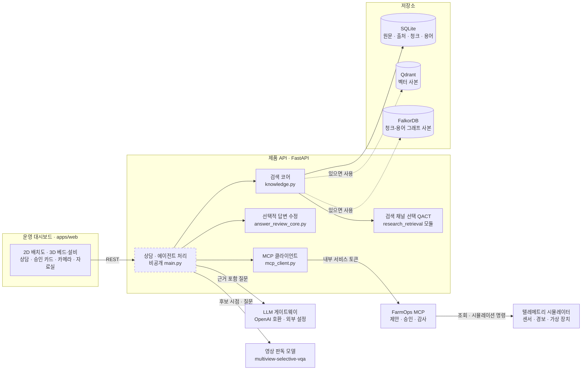

- **SQLite가 원본**이고 Qdrant·FalkorDB는 사본입니다. 사본이 없으면 SQLite에 저장한 벡터와 `chunk_terms` 테이블로 같은 계산을 합니다.
- 임베딩 기본값은 FastEmbed `paraphrase-multilingual-MiniLM-L12-v2`입니다. 모델을 불러오지 못하면 `lexical-hash-v2` 대체 임베딩을 쓰고, 상태 값에 대체 모드임을 표시합니다.
- 농장 전용 자료는 외부 LLM에 보내지 않고 로컬 요약으로 답합니다.

### 업무별 처리 흐름

같은 구역과 베드를 기준으로 연결하되, 문서 검색, 영상 판독, 상태 재검토는 그 업무가 필요할 때만 수행합니다. 번호는 아래 흐름의 단계입니다.

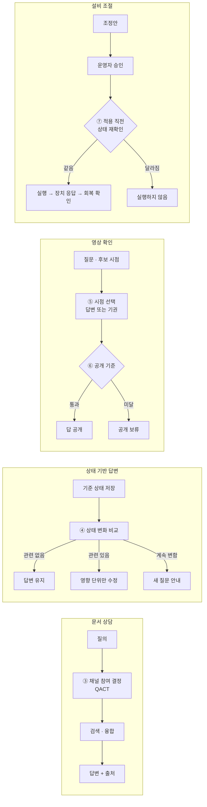

## 핵심 기술

### 1. 질의 적응형 검색 채널 제어 (QACT)

질문 유형에 따라 어떤 검색 채널을 얼마의 비중으로 쓸지 정하는 방식입니다. 설정은 오프라인에서 만든 릴리스 JSON에 담고, 서비스는 이 파일을 검증한 뒤에만 사용합니다.

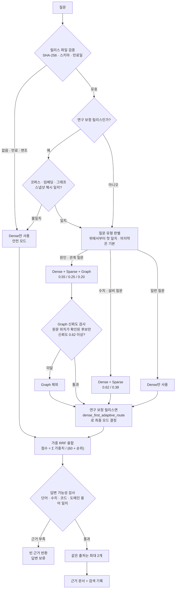

| 단계 | 구현 내용 | 위치 |
|---|---|---|
| 릴리스 검증 | 파일 SHA-256이 설정값과 같고, 스키마 `smartfarm-qact-release-v2`·만료일·스냅샷 해시 형식이 맞아야 `valid`. 안전 경로는 반드시 Dense 단독이어야 하고, 마지막 질문 유형은 기본 경로여야 함 | `load_qact_release_profile()` |
| 질문 유형 판별 | 릴리스에 적힌 키워드 목록을 위에서부터 비교해 첫 번째로 맞는 유형의 채널·가중치·임계값을 반환 | `QactReleaseProfile.route()` |
| Dense | 질문 벡터와 청크 벡터의 코사인 유사도. Qdrant 우선, 없으면 SQLite 벡터로 계산 | `_qdrant_dense_scores()`, `_local_dense_scores()` |
| Sparse | 질문 토큰이 청크 본문·메타데이터에 얼마나 겹치는지의 비율. BM25는 쓰지 않음 | `_sparse_scores()` |
| Graph | FalkorDB `(Chunk)-[:MENTIONS]->(Term)` 탐색, 없으면 SQLite `chunk_terms`로 대체 | `_graph_scores()` |
| Graph 신뢰도 검사 | 신뢰도 = 0.5 × 출처 검증 비율 + 0.3 × 단어 일치 강도 + 0.2 × Dense 상위 결과와의 일치도. 임계값 미만이면 Graph 제외 | `_graph_scores_with_gate()` |
| 융합 | 채널별 순위에 가중치를 곱한 Reciprocal Rank Fusion, `rrf_k = 60` | `_fuse()` |
| 답변 가능성 검사 | 질문의 수치·코드·도메인 용어·핵심 단어가 근거에 실제로 있는지 규칙으로 확인. 통과 못 하면 근거를 비움 | `_answerability()` |
| 출처 다양성 | 같은 출처에서 최대 2개 청크만 반환 | `_diverse_ranked()` |

연구 코드에서 옮긴 `dense_first_adaptive_route()`는 정규화된 Graph 가중치가 0.35를 넘고 검증된 Graph 근거가 있을 때만 3채널 융합을 고릅니다. 그 외에는 Graph를 끄고, 보정하지 않은 균등 가중치(0.34/0.33/0.33, 허용 오차 0.02)면 Dense 단독, Sparse 가중치가 0.40 이상이면 Dense+Sparse, 나머지는 Dense 단독으로 갑니다. 파일 바이트(CRLF 포함)의 SHA-256을 [`research-algorithm.json`](data/qact-profile/research-algorithm.json)에 고정했고, [`.gitattributes`](.gitattributes)로 줄바꿈 변환을 막았습니다.

> [!NOTE]
> [`demo-release.json`](data/qact-profile/demo-release.json)은 회귀 테스트용 데모 릴리스입니다. 질문 유형 키워드와 가중치는 현장에서 검증한 값이 아니며, 논문의 성능 수치를 재현하지 않습니다.

### 2. 승인형 설비 제어 흐름

[`services/farm-mcp`](services/farm-mcp)의 `FarmOperationsService`와 [`mcp_client.py`](services/api/app/mcp_client.py)가 이 흐름을 구현합니다. 웹 콘솔은 [`apps/web`](apps/web)의 설비 조절 카드이고, 제품 API 엔드포인트(`/v1/control-proposals`)는 비공개 원본 기준으로 그렸습니다.

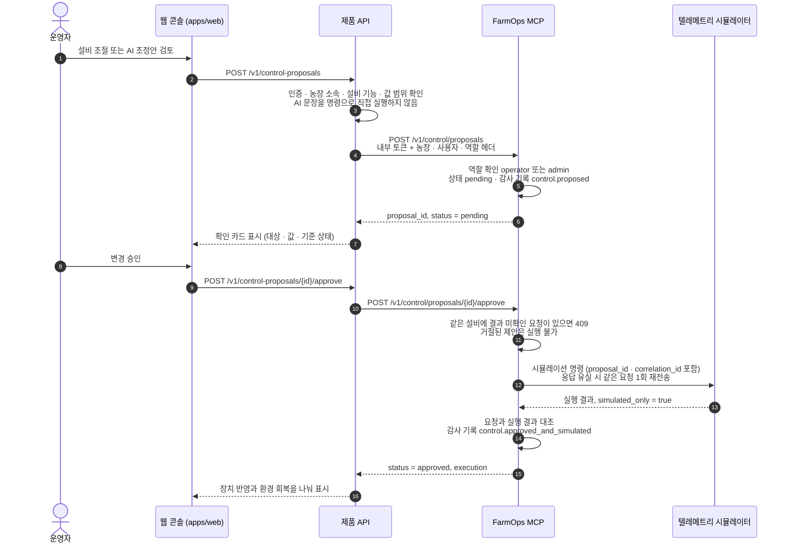

- MCP 도구는 조회 7개(`get_farm_snapshot`, `get_sensor_timeseries`, `list_alerts`, `list_farm_devices`, `get_device_capabilities`, `preview_control_impact`, `track_recent_executions`)와 변경 3개(`propose_control_action`, `approve_control_proposal`, `reject_control_proposal`)입니다. 도구 입력에는 `farm_id`가 없고, 농장 정보는 신뢰된 헤더로만 받습니다.
- 장치 연결부는 `DeviceCommandAdapter` 인터페이스(`describe_capabilities → read_snapshot → request_command → read_command_status → confirm_outcome`)로 분리했습니다. 현재 구현은 시뮬레이터 어댑터 하나입니다.

### 3. 센서 변화 기반 선택적 답변 수정

상담한 뒤 센서 값이 바뀌면, 예전 답을 믿고 설비를 움직이는 실수가 생길 수 있습니다. [`answer_review_core.py`](services/api/app/answer_review_core.py)는 답을 세 부분(상태 설명, 행동 안내, 관측 근거)으로 나누고, 답을 만들기 **전에** 각 부분이 기대는 관측을 선언합니다. 이후 상태가 바뀌면 바뀐 값에 기대는 부분만 다시 씁니다. 생성된 문장을 읽고 판단하지 않습니다.

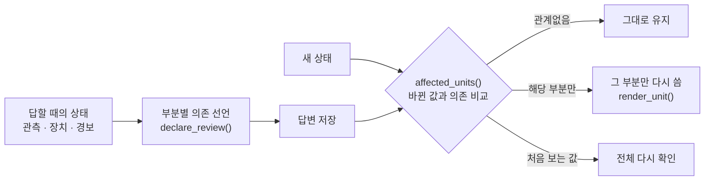


- 현재 상태 질문은 정상 범위 안의 작은 흔들림을 무시하고 범위 이탈, 품질 이상, 5분 넘은 관측, 장치·경보 변화만 비교합니다. 재배 지식 질문은 센서 흔들림을 따라가지 않습니다.
- 다른 구역의 변화는 이 답에 영향을 주지 않습니다(그림의 "B구역 값이 바뀌었다면 0/3"). 한 번 고친 뒤에도 값이 계속 바뀌면 고쳐 쓰는 대신 새로 물어보도록 안내합니다.
- 시험은 [`test_answer_review_core.py`](services/api/tests/test_answer_review_core.py)에 있습니다. 이 저장소의 코드는 제품에 쓰는 구조화 규칙이며, 자유 형식 LLM 문장을 부분 수정하는 성능을 검증한 결과는 아닙니다.

### 4. 운영 대시보드

[`apps/web`](apps/web)은 React 19, TypeScript, Three.js, Vite로 만든 운영 화면입니다. 화면별 구성은 위의 [화면 구성](#화면-구성)에 정리했습니다.

| 구성 | 위치 | 내용 |
|---|---|---|
| 농부 화면 | [`src/farmer/FarmerWorkspace.tsx`](apps/web/src/farmer/FarmerWorkspace.tsx) | 배치도, 패널, 상담 창, 카메라, 자료실을 한 화면 흐름으로 연결 |
| 2D 배치도 | [`src/farmer/FarmPlan.tsx`](apps/web/src/farmer/FarmPlan.tsx) | SVG로 그린 온실 평면, 설비 상태와 배관 흐름, AI 우선순위 핀 |
| 3D 모형 | [`src/farmer/FarmMap.tsx`](apps/web/src/farmer/FarmMap.tsx), [`farm-models.ts`](apps/web/src/farmer/farm-models.ts) | glTF 온실 모형(베드 18개 × 4단)과 절차적으로 만든 설비 모형, 보고값에 따른 움직임 |
| AI 브리핑 | [`src/farmer/ai-brief.ts`](apps/web/src/farmer/ai-brief.ts) | 경보, 센서 교차 확인, 설비 보고, 카메라 기록, 재배 일정을 묶어 먼저 볼 곳의 순위를 정함 |
| 기록 재생 | [`src/demo/replay.ts`](apps/web/src/demo/replay.ts) | `VITE_DEMO_STATIC=1`로 빌드하면 모든 API 요청을 기록으로 답함. 기록 시각은 지금으로 옮기고 실시간 값은 10분 기록을 반복 재생 |

데모의 기록과 GitHub Pages 배포는 [`demo`](https://github.com/NAMUORI00/smartfarm-adaptive-rag/tree/demo) 브랜치에 있습니다. 기록 때 실제로 물은 추천 질문과 카메라·연구 실행만 답이 있고, 그 밖의 질문에는 기록에 없다고 답합니다. 설비 조절과 카메라 확인 기록 닫기는 그 브라우저 안에서만 반영됩니다.


## 연구 성과

| 연구 | 논문 | 상태 | 코드 |
|---|---|---|---|
| 질의 적응형 검색 채널 제어 | 김유석, 김용운, 변영철, 「스마트팜 RAG를 위한 질의 적응형 검색 채널 제어」, *한국정보기술학회논문지*, 24(6), pp. 99–108, 2026. [doi:10.14801/jkiit.2026.24.6.99](https://doi.org/10.14801/jkiit.2026.24.6.99) | KCI 등재지 게재, 제1저자 | 이 저장소 [`services/api`](services/api) |
| 근거 조건부 응답·기권 | 김유석, 김용운, 변영철, "Role-Separated Selective Response for Question Answering in Multi-View Video Surveillance", *IEEE Access* | 심사 중, 제1저자 | [multiview-selective-vqa](https://github.com/NAMUORI00/multiview-selective-vqa) |
| 센서 변화 기반 선택적 답변 수정과 시스템 통합 | 김유석, 「적응형 검색과 선택적 답변 처리를 적용한 스마트팜 AI 운영 지원 시스템의 설계 및 구현」, 제주대학교 석사학위논문 | 작성 중(2027년 2월 예정) | 이 저장소 [`answer_review_core.py`](services/api/app/answer_review_core.py), [`apps/web`](apps/web) |

논문의 채널 제어를 운영 검색 경로에 연결하면서 체크섬 고정 릴리스, 스냅샷 해시 검증, Graph 신뢰도 검사, Dense 안전 모드를 더했습니다. 실험 코드, 데이터, 결과표는 비공개 연구 저장소에 있습니다.

## 나의 기여

**김유석 ([@NAMUORI00](https://github.com/NAMUORI00))** — 연구와 개발을 단독으로 진행했습니다. 비공개 원본 저장소 기준 2026-07-16 ~ 2026-10-07 동안 커밋 268개를 모두 본인 계정으로 작성했습니다.

| 영역 | 직접 설계·구현한 내용 | 관련 파일 | 결과 |
|---|---|---|---|
| 연구 | 질의 적응형 검색 채널 제어(QACT) 설계, 비교 실험, 논문 작성 | [`research_retrieval_algorithm.py`](services/api/app/research_retrieval_algorithm.py), [`research-algorithm.json`](data/qact-profile/research-algorithm.json) | KCI 논문 제1저자 게재. 연구 코드의 라우팅 함수를 수정 없이 옮기고, 파일 SHA-256을 고정해 변경 여부를 테스트로 확인 |
| 검색 코어 | SQLite 원본 + Qdrant·FalkorDB 사본 구조, 문서 수집·청킹·출처 식별, 3채널 점수와 가중 RRF 융합, Graph 신뢰도 검사, 답변 가능성 검사, 출처 다양성 제한, 검색 기록(trace) | [`knowledge.py`](services/api/app/knowledge.py), [`pdf_extractor.py`](services/api/app/pdf_extractor.py) | 외부 DB가 없어도 SQLite만으로 같은 검색이 동작. 어떤 채널·백엔드를 썼는지 trace에 남음 |
| QACT 릴리스 계약 | 질문 유형·허용 채널·가중치·임계값을 담는 v2 JSON 스키마, 체크섬·만료일·스냅샷 해시 검증, 실패 시 Dense 안전 모드, 보정 릴리스 내보내기 도구 | [`demo-release.json`](data/qact-profile/demo-release.json), [`research_retrieval.py`](services/api/app/research_retrieval.py), [`export_research_qact.py`](tools/export_research_qact.py) | 검증되지 않은 설정이 운영 검색에 들어가지 않음. 개발/검증 데이터 분할이 겹치거나 품질 검증에 실패한 보정 결과는 내보내기 단계에서 거부 |
| 승인형 제어 (FarmOps MCP) | MCP 도구 10개, 제안→승인→시뮬레이션→감사 상태 관리, 역할·내부 토큰·농장 헤더 검사, 같은 설비 중복 요청 차단, 응답 유실 시 1회 재전송과 결과 대조, W3C WoT 형식 장치 프로필 | [`services/farm-mcp/app/`](services/farm-mcp/app), [`mcp_client.py`](services/api/app/mcp_client.py), [`wasabi-greenhouse-v1.json`](data/device-manifests/wasabi-greenhouse-v1.json) | AI 응답이 설비 명령으로 바로 실행되는 경로가 없음. MCP가 응답하지 않으면 승인도 실행되지 않음 |
| 온실 시뮬레이터 | 펄라이트 고설베드 고추냉이 온실 모델, 장치 조작과 센서 변화의 인과 연결, 임계값·센서 상태·작물 위험 경보 구분, 시나리오 10종, 가상 시계, SQLite 상태 저장, 외부 수집 데이터 사전 검증(dry-run) | [`services/telemetry/app/`](services/telemetry/app), [`wasabi-prototype-v1.json`](data/scenarios/wasabi-prototype-v1.json) | 실제 장비 없이 경보 발생 → 조치 제안 → 승인 → 환경 회복 흐름을 재현 |
| 운영 대시보드 | 온실 2D 배치도와 AI 브리핑, 베드·설비 3D 모형(Three.js), 출처 번호가 붙은 상담, 설비 변경 확인·허용 카드, 카메라 관제, 자료실과 근거 원문 읽기, 한국어·영어, 기록 재생 데모 모드 | [`apps/web/`](apps/web), [`replay.ts`](apps/web/src/demo/replay.ts) | 서버 없이 GitHub Pages에서 동작하는 데모. 웹 테스트 318개 |
| 선택적 답변 수정 | 답을 상태 설명·행동 안내·관측 근거로 나누고, 답하기 전에 각 부분이 기대는 관측을 선언해, 값이 바뀌면 그 값에 기대는 부분만 다시 쓰는 규칙 | [`answer_review_core.py`](services/api/app/answer_review_core.py) | 정상 범위 안의 흔들림은 무시하고, 범위 이탈·품질 이상·오래된 관측·처음 보는 값은 다시 확인 |
| 테스트·CI | 서비스별 회귀 테스트, 라우팅 기준 세트(golden suite), 웹 테스트, GitHub Actions | `services/*/tests/`, `apps/web/src/*.test.ts`, [`qact-routing-golden.json`](data/rag-eval/qact-routing-golden.json), [`ci.yml`](.github/workflows/ci.yml) | Python 254개, 웹 318개 테스트 통과 |

**AI 코딩 도구 사용**: 구현 과정에서 Codex와 Claude Code를 페어 프로그래밍 도구로 사용했습니다. 요구사항, 설계 결정, 안전 경계, 검증 기준은 직접 정했고 생성된 코드는 리뷰와 테스트로 확인했습니다.

## 기술 스택

| 영역 | 기술 |
|---|---|
| 언어·프레임워크 | Python 3.12, FastAPI, Pydantic v2, Uvicorn |
| 검색·저장 | SQLite, Qdrant(REST), FalkorDB(Cypher), FastEmbed, 연구 환경용 sentence-transformers(선택) |
| 도구 연동 | MCP 호환 JSON-RPC(`initialize`, `tools/list`, `tools/call`) + REST |
| 문서 처리 | pypdf, BeautifulSoup, lxml, Pillow |
| 대시보드 | React 19, TypeScript, Three.js(glTF), Vite, pdf.js, docx-preview |
| 실행·검증 | Docker Compose, pytest, httpx, node:test, GitHub Actions, GitHub Pages |

## 실행 방법

```bash
git clone https://github.com/NAMUORI00/smartfarm-adaptive-rag.git
cd smartfarm-adaptive-rag
```

### 대시보드 데모

설치 없이 데모 주소에서 볼 수 있습니다. 로컬에서 띄울 때는 기록이 들어 있는 `demo` 브랜치에서 실행합니다.

```bash
git switch demo
cd apps/web && npm ci
VITE_DEMO_STATIC=1 npm run dev   # 기록 재생 모드, http://localhost:3000
```

### 검색 코어 직접 호출 (외부 서비스 불필요)

`services/api`에서 실행합니다. Qdrant·FalkorDB 없이 SQLite 경로로 동작하고, `hash` 임베딩을 쓰므로 모델을 내려받지 않습니다.

```python
from hashlib import sha256
from pathlib import Path
from app.knowledge import KnowledgeStore, EmbeddingRuntime, load_qact_release_profile

release = Path("../../data/qact-profile/demo-release.json")
profile = load_qact_release_profile(str(release), sha256(release.read_bytes()).hexdigest())
question = "근권 온도가 상승한 원인과 산소 공급의 관계는?"
route = profile.route(question)  # causal_relationship → dense + sparse + graph

store = KnowledgeStore(":memory:", embedding_runtime=EmbeddingRuntime(provider="hash"))
store.seed_defaults()  # data/demo-corpus 문서 6개
res = store.retrieve(
    query=question, farm_id="farm-wasabi-a", include_private=True, selected_document_ids=None,
    retrieval_path=route["retrieval_path"], channel_weights=route["channel_weights"],
    graph_reliability_threshold=route["graph_reliability_threshold"],
)
print(res.trace["fusion"], res.trace["graph_gate"]["reason"], res.trace["answerable"])
for hit in res.hits:
    print(hit.score, hit.channels, hit.title)
```

체크섬을 틀리게 넣으면(`load_qact_release_profile(str(release), "0" * 64)`) `route()`가 `["dense"]`만 반환합니다.

### MCP + 시뮬레이터 실행 (Docker Compose)

```bash
cp .env.example .env      # 로컬 전용 토큰 값을 바꿔서 사용
docker compose up --build # telemetry: 127.0.0.1:8120, farm-mcp: 127.0.0.1:8110
```

```bash
set -a && . ./.env && set +a   # MCP_SERVICE_TOKEN 불러오기
H=(-H "X-Internal-Service-Token: $MCP_SERVICE_TOKEN" -H "X-Farm-Id: farm-wasabi-a" \
   -H "X-Actor-Id: operator-01" -H "X-Actor-Role: operator")

# 제안 생성 → 승인(시뮬레이터 반영) → 감사 기록 조회
curl -X POST http://127.0.0.1:8110/v1/control/proposals "${H[@]}" -H "Content-Type: application/json" \
  -d '{"action":"set_circulation_fan_percent","target_value":60,"zone_id":"zone-a","rationale":"humidity rising"}'
curl -X POST http://127.0.0.1:8110/v1/control/proposals/<proposal_id>/approve "${H[@]}"
curl http://127.0.0.1:8110/v1/audit/events "${H[@]}"
```

토큰이 없으면 401, `viewer` 역할로 제안하면 403입니다. 도구 목록은 `POST /mcp`에 `{"jsonrpc":"2.0","id":1,"method":"tools/list"}`로 확인할 수 있습니다.

## 테스트

```bash
cd services/api       && pip install -r requirements-dev.txt && python -m pytest -q
cd ../farm-mcp        && pip install -r requirements-dev.txt && python -m pytest -q
cd ../telemetry       && pip install -r requirements-dev.txt && python -m pytest -q
cd ../../apps/web     && npm ci && npm test && npm run build
```

| 서비스 | 테스트 수 | 주요 검증 내용 |
|---|---|---|
| `services/api` | 106 | 릴리스 검증·만료·변조 시 Dense 안전 모드, 라우팅 golden suite, 연구 알고리즘 경계값·해시 무결성, Graph 신뢰도 검사, 답변 보류, 재색인, MCP 클라이언트, 선택적 답변 수정 |
| `services/farm-mcp` | 46 | 제안·승인·거절 상태 전이, 역할·토큰 검사, 감사 기록, 장치 어댑터, JSON-RPC 도구 |
| `services/telemetry` | 102 | 장치 조작에 따른 센서 변화, 경보 발생·해제, 상태 저장, 다운샘플링, 수집 데이터 검증 |
| `apps/web` | 318 | AI 브리핑 순위, 경보·설비 상태 문구, 카메라 판독 표시, 상담 근거 묶음, 생육 표현, 기록 재생 규칙 |

- 2026-10-09 로컬(Windows)에서 Python 254개와 웹 318개가 모두 통과했습니다. CI는 Python 3.12에서 세 서비스를, Node 22에서 웹을 실행합니다.
- 테스트는 소프트웨어 회귀 검증입니다. 현장 검색 품질이나 물리 장치 안전성을 검증한 결과는 아닙니다.

## 디렉터리 구조

```text
smartfarm-adaptive-rag/
├── apps/web/                 # 운영 대시보드 (React · Three.js · Vite)
│   ├── src/farmer/           # 배치도 · 3D · 상담 · 설비 · 카메라 · 자료실 화면
│   ├── src/demo/             # 기록 재생 모드 (demo 브랜치의 기록으로 동작)
│   └── public/models/        # 고설베드 온실 3D 모형 (glTF)
├── services/
│   ├── api/                  # 제품 API 중 검색 코어만 발췌 (main.py 제외)
│   │   ├── app/
│   │   │   ├── knowledge.py                    # 문서 저장·QACT 로딩·3채널 검색·융합·답변 보류
│   │   │   ├── research_retrieval_algorithm.py # 연구 라우팅 함수 (해시 고정, CRLF 유지)
│   │   │   ├── research_retrieval.py           # 연구 정책 검증, 스냅샷 해시, 릴리스 내보내기
│   │   │   ├── answer_review_core.py           # 센서 변화 기반 선택적 답변 수정 규칙
│   │   │   ├── mcp_client.py                   # 제품 API → FarmOps MCP 클라이언트
│   │   │   └── research_embedding.py · agent_state.py · pdf_extractor.py
│   │   └── tests/
│   ├── farm-mcp/             # 승인형 제어 MCP 서비스
│   └── telemetry/            # 고추냉이 온실 텔레메트리 시뮬레이터
├── data/
│   ├── qact-profile/         # demo-release.json, research-algorithm.json
│   ├── rag-eval/             # QACT 라우팅 golden suite
│   ├── demo-corpus/          # 공개 자료를 요약한 데모 문서 6개 (출처 링크 포함)
│   ├── device-manifests/     # WoT 형식 장치 프로필
│   └── crop-profiles/ · scenarios/ · telemetry-adapters/
├── docs/images/               # README 화면 캡처
├── tools/export_research_qact.py
├── compose.yaml              # telemetry + farm-mcp 실행
└── .env.example
```

## 향후 작업

- [ ] 실제 센서를 읽기 전용으로 연결해 관측 주기, 결측, 지연, 재접속을 점검하고, 수집한 시계열을 같은 조건으로 재생해 상태 변화 대응을 비교
- [ ] 실제 LLM으로 선택적 답변 수정의 품질과 토큰·시간 비용을 측정하고, 여러 단위가 함께 바뀌는 경우와 의존관계 오류를 평가
- [ ] 영상 공개 기준을 온실 자료로 다시 학습하고 독립 검증
- [ ] 운영자 평가로 업무 수행 시간, 판단 오류, 사용성을 확인
- [ ] 보정 릴리스 품질 기준 재검증 (실제 농장 코퍼스의 개발/검증 분할 기준, 통과 전까지 Dense 안전 모드 유지)
- [ ] 키워드 기반 질문 유형 판별을 평가 데이터 기반 분류로 개선
- [ ] Sparse 채널을 BM25 또는 한국어 형태소 분석 기반 검색으로 교체
- [ ] Graph 채널을 청크-용어 공출현에서 엔터티·관계 추출 기반 지식 그래프로 확장
- [ ] `TelemetryIngressRequest`, `DeviceCommandAdapter`에 MQTT·Modbus·OPC UA 어댑터 연결
- [ ] 내부 토큰·신뢰 헤더 방식을 사용자 인증, 비밀 관리, 테넌트 격리 검증으로 강화

## 공개 범위 안내

- 비공개 연구 저장소에서 **직접 작성한 핵심 코드만 골라 정리한 공개용 쇼케이스**입니다. 커밋 이력은 원본 개발 이력이 아닙니다.
- 제품 API의 상담·에이전트 처리(`main.py`), 학위논문 원고, 실험 산출물은 포함하지 않았습니다. 따라서 이 저장소만으로 실시간 제품을 실행할 수는 없고, 대시보드는 기록 재생 모드로 동작합니다.
- 영상 연구(근거가 충분할 때만 답하는 다중 시점 CCTV 질의응답)는 [multiview-selective-vqa](https://github.com/NAMUORI00/multiview-selective-vqa)에 있습니다.
- 데모의 카메라 영상은 예시 사진을 첫 장면으로 영상 생성 AI(Wan 2.2 TI2V-5B, Apache-2.0)가 만든 장면이고, 공개 데이터셋(AIHub 다시점 CCTV) 화면은 연구 흐름에 쓰인 일부만 실었습니다. 재배 자료는 목록과 답변이 인용한 쪽만 실었습니다.
- 모든 센서와 설비는 시뮬레이터입니다. 실제 장비에는 연결하지 않습니다.
- 라이선스: 별도 라이선스 없음 (열람 목적 공개)

- 문의: GitHub [@NAMUORI00](https://github.com/NAMUORI00)

## 참고문헌

1. S. Wolfert, L. Ge, C. Verdouw, and M.-J. Bogaardt, "Big data in smart farming—a review," *Agricultural Systems*, vol. 153, pp. 69–80, 2017. doi:10.1016/j.agsy.2017.01.023
2. P. Lewis et al., "Retrieval-augmented generation for knowledge-intensive NLP tasks," *NeurIPS*, vol. 33, pp. 9459–9474, 2020.
3. 이현병, 최인찬, 임동혁 외, 「LLM과 RAG를 활용한 스마트팜 제어 및 관리 지원 시스템 설계 및 구현」, *한국콘텐츠학회논문지*, 24(12), pp. 65–76, 2024. doi:10.5392/JKCA.2024.24.12.065
4. D. F. Kandamali et al., "CottonBot: An AI-driven cotton farming assistant and irrigation advisor using LLM-RAG and agentic AI tools," *Smart Agricultural Technology*, vol. 12, 101640, 2025. doi:10.1016/j.atech.2025.101640
5. S. Pardo-Pina et al., "An agent-based service architecture for smart greenhouses: Telemetry analytics and decision support with RAG-grounded LLM agents," *Smart Agricultural Technology*, vol. 13, 101872, 2026. doi:10.1016/j.atech.2026.101872
6. S. Robertson and H. Zaragoza, "The probabilistic relevance framework: BM25 and beyond," *Foundations and Trends in Information Retrieval*, 3(4), pp. 333–389, 2009. doi:10.1561/1500000019
7. H. Joren et al., "Sufficient context: A new lens on retrieval augmented generation systems," *ICLR*, 2025.
8. M. Mansoor, T. Ahmad, and Y.-C. Yoon, "Risk-constrained freshness-aware semantic caching for open-web retrieval-augmented LLMs," arXiv:2607.04281, 2026.
9. 강태욱, 신창선, 박장우, 박철영, 「인공지능 모델 통합 제어를 위한 LLM 기반 지능형 스마트팜 에이전트 시스템 구현」, *스마트미디어저널*, 14(12), pp. 66–73, 2025.
10. V. Karpukhin et al., "Dense passage retrieval for open-domain question answering," *EMNLP*, pp. 6769–6781, 2020. doi:10.18653/v1/2020.emnlp-main.550
11. G. V. Cormack, C. L. A. Clarke, and S. Büttcher, "Reciprocal rank fusion outperforms Condorcet and individual rank learning methods," *SIGIR*, pp. 758–759, 2009. doi:10.1145/1571941.1572114
12. S. Jeong et al., "Adaptive-RAG: Learning to adapt retrieval-augmented large language models through question complexity," *NAACL*, 2024.
13. A. Asai et al., "Self-RAG: Learning to retrieve, generate, and critique through self-reflection," *ICLR*, 2024.
14. H.-L. Hsu and J. Tzeng, "DAT: Dynamic alpha tuning for hybrid retrieval in retrieval-augmented generation," arXiv:2503.23013, 2025.
15. 김유석, 김용운, 변영철, 「스마트팜 RAG를 위한 질의 적응형 검색 채널 제어」, *한국정보기술학회논문지*, 24(6), pp. 99–108, 2026. doi:10.14801/jkiit.2026.24.6.99
16. Y. Hou, S. Gould, and L. Zheng, "Learning to select views for efficient multi-view understanding," *CVPR*, pp. 20135–20144, 2024. doi:10.1109/CVPR52733.2024.01903
17. E. Yoon et al., "Can video LLMs refuse to answer? Alignment for answerability in video large language models," *ICLR*, 2025.
18. B. Vardi, O. Nir, and A. Shamir, "CLIP-UP: CLIP-based unanswerable problem detection for visual question answering," *WACV*, pp. 5898–5908, 2026.
19. Z. Jiang et al., "Active retrieval augmented generation," *EMNLP*, pp. 7969–7992, 2023. doi:10.18653/v1/2023.emnlp-main.495
20. W. Su et al., "DRAGIN: Dynamic retrieval augmented generation based on the real-time information needs of large language models," *ACL*, pp. 12991–13013, 2024. doi:10.18653/v1/2024.acl-long.702
21. W. Huang et al., "Inner monologue: Embodied reasoning through planning with language models," *CoRL*, PMLR vol. 205, pp. 1769–1782, 2023.
22. J. Kim, C. Min, B. Kim, and J. Choi, "Pre-emptive action revision by environmental feedback for embodied instruction following agents," *CoRL*, PMLR vol. 270, pp. 2396–2428, 2025.
