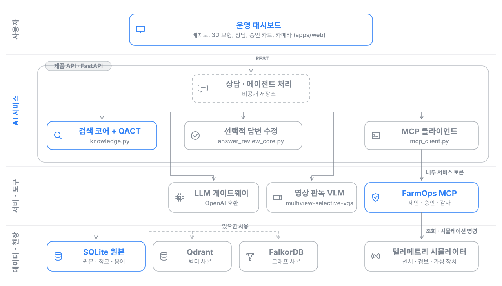
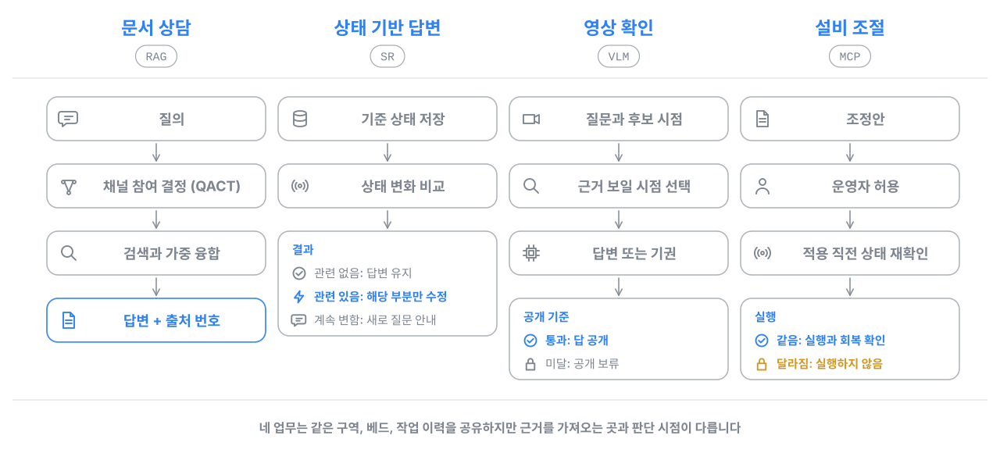
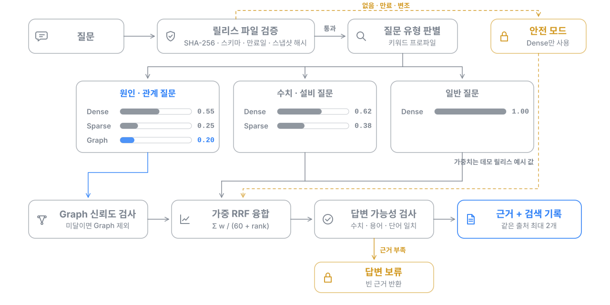
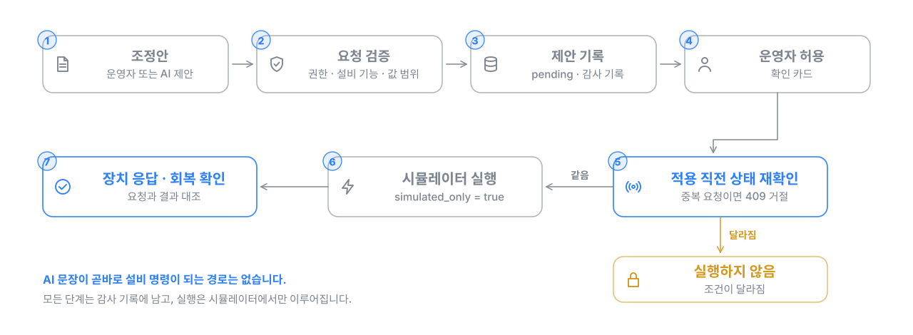

# Smartfarm Adaptive RAG

고추냉이 고설베드 온실을 대상으로 만든 스마트팜 AI 운영 지원 시스템입니다. 재배 자료 상담, 카메라 확인, 센서 변화에 따른 답변 갱신을 서로 다른 처리 경로로 나누고, AI가 쓰는 설명과 설비를 움직이는 권한을 분리했습니다.


[](https://github.com/NAMUORI00/smartfarm-adaptive-rag/actions/workflows/ci.yml)

**[라이브 데모](https://namuori00.github.io/smartfarm-adaptive-rag/)**: 기록해 둔 운영 데이터와 AI 응답을 서버 없이 브라우저에서 재생합니다.


## 요약

| 항목 | 내용 |
|---|---|
| 개발 | 김유석 (제주대학교 대학원 석사과정). 연구부터 설계, 구현까지 1인 개발 (2026년 7월 ~ 10월) |
| 운영 대상 | 고추냉이 온실 시뮬레이터: 2개 구역, 베드 18개(각 4단), 관측 항목 40개, 설비 16대, 카메라 4대 |
| 연구 | 질의 적응형 검색 채널 제어: KCI 등재지 게재, 제1저자<br>근거 조건부 응답과 기권: IEEE Access 심사 중, 제1저자<br>센서 변화 기반 선택적 답변 수정: 석사학위논문 |
| 주요 결과 | 공개 검색 벤치마크 3종에서 nDCG@10이 고정 프로파일 적응 융합보다 0.023~0.087 높음(유의)<br>다시점 관제 영상에서 정답 공개율이 기권 프롬프트보다 41.2%p 높고, 선택된 가용 시점 260개에서 오답 공개 0건<br>전체 재생성과 같은 응답–상태 일치(110/110)를 유지하며 다시 생성하는 답변 단위 26.5% 감소 |
| 구현 | 검색 코어, 승인형 설비 제어 서비스(MCP), 온실 시뮬레이터 (Python, FastAPI)<br>베드와 설비를 3D로 재현한 운영 대시보드 (React, Three.js)<br>자동 테스트 572개와 GitHub Actions CI |

## 화면 구성

<table>
  <tr>
    <td width="50%"><br><b>온실 배치도와 AI 브리핑</b><br>센서, 설비, 카메라, 재배 기록을 함께 보고 먼저 확인할 곳에 순서를 매깁니다.</td>
    <td width="50%"><br><b>설비 3D와 조절 카드</b><br>장치 보고값에 맞춰 모형이 움직이고, 변경 확인부터 회복 확인까지 카드 하나에서 진행합니다.</td>
  </tr>
  <tr>
    <td width="50%"><br><b>AI 농장 상담</b><br>고른 구역의 관측을 함께 넣어 답하고, 문장마다 출처 번호를 붙입니다.</td>
    <td width="50%"><br><b>카메라 관제</b><br>장면이 바뀔 때만 AI가 판독하고, 확인이 필요한 장면은 사람이 확인한 뒤 닫습니다.</td>
  </tr>
</table>

## 시스템 구조



- 원본 데이터는 SQLite에 두고 Qdrant와 FalkorDB는 사본으로 씁니다. 사본이 없어도 SQLite만으로 같은 검색이 동작합니다.
- 농장 전용 자료가 섞인 질문은 외부 LLM에 보내지 않고 로컬에서 요약해 답합니다.
- 점선으로 표시한 상담 처리 모듈은 공개 저장소에 포함하지 않았습니다.

## 업무별 처리 흐름



## 핵심 기술

### 1. 질의 적응형 검색 채널 제어 (QACT)



질문 유형에 따라 의미 검색(Dense), 낱말 검색(Sparse), 관계 검색(Graph) 가운데 무엇을 어느 비중으로 결합할지 정합니다. 설정은 체크섬을 고정한 릴리스 파일로만 바꿀 수 있고, 검증에 실패하면 Dense만 쓰는 안전 모드로 동작합니다. 공개 벤치마크 3종에서 nDCG@10이 고정 프로파일 적응 융합보다 0.023~0.087 높았고, 이 결과를 KCI 등재지에 제1저자로 게재했습니다.

### 2. 승인형 설비 제어 (FarmOps MCP)



AI가 쓰는 설명과 설비 실행 권한을 분리했습니다. MCP 도구 10개(조회 7개, 변경 3개)를 제공하고, 운영자가 허용한 뒤에도 적용 직전에 상태를 다시 읽어 조건이 달라졌으면 실행하지 않습니다. 모든 요청은 감사 기록에 남습니다.

### 3. 센서 변화 기반 선택적 답변 수정


답을 상태 설명, 행동 안내, 관측 근거로 나누고 각 부분이 기대는 관측을 미리 선언합니다. 상태가 바뀌면 그 값에 기대는 부분만 다시 써서, 전체 재생성과 같은 응답–상태 일치(110/110)를 유지하면서 다시 생성하는 답변 단위를 26.5% 줄였습니다. 연구 엔진과 평가는 [smartfarm-state-revalidation](https://github.com/NAMUORI00/smartfarm-state-revalidation)에 있습니다.

### 4. 근거 조건부 영상 응답

카메라 질문에는 근거가 보일 가능성이 높은 시점을 먼저 고르고, 근거가 부족하면 답을 보류하도록 학습한 VLM으로 답합니다. 기권 프롬프트보다 정답 공개율이 41.2%p 높았고, 선택된 가용 시점 260개에서 오답을 하나도 공개하지 않았습니다. 연구 코드는 [multiview-selective-vqa](https://github.com/NAMUORI00/multiview-selective-vqa)에 있습니다.

### 5. 운영 대시보드

React 19, TypeScript, Three.js로 만들었습니다. 온실 배치도와 AI 브리핑, 베드와 설비 3D 모형, 출처가 붙는 상담, 설비 승인 카드, 카메라 관제를 한 화면 흐름으로 연결했고, 기록 재생 모드로 서버 없이 GitHub Pages에서 동작합니다.

구현 수준의 설명(함수, 상수, API 흐름, MCP 도구 목록)은 [docs/architecture.md](docs/architecture.md)에 정리했습니다.

## 연구 성과

| 연구 | 논문 | 상태 | 코드 |
|---|---|---|---|
| 질의 적응형 검색 채널 제어 | 김유석, 김용운, 변영철, 「스마트팜 RAG를 위한 질의 적응형 검색 채널 제어」, *한국정보기술학회논문지*, 24(6), pp. 99–108, 2026. [doi:10.14801/jkiit.2026.24.6.99](https://doi.org/10.14801/jkiit.2026.24.6.99) | KCI 등재지 게재, 제1저자 | 이 저장소 [`services/api`](services/api) |
| 근거 조건부 응답과 기권 | 김유석, 김용운, 변영철, "Role-Separated Selective Response for Question Answering in Multi-View Video Surveillance", *IEEE Access* | 심사 중, 제1저자 | [multiview-selective-vqa](https://github.com/NAMUORI00/multiview-selective-vqa) |
| 선택적 답변 수정과 시스템 통합 | 김유석, 「적응형 검색과 선택적 답변 처리를 적용한 스마트팜 AI 운영 지원 시스템의 설계 및 구현」, 제주대학교 석사학위논문 | 2027년 2월 예정 | [smartfarm-state-revalidation](https://github.com/NAMUORI00/smartfarm-state-revalidation), 이 저장소 |

연구 배경과 관련 연구 비교, 참고문헌은 [docs/background.md](docs/background.md)에 있습니다.

## 기술 스택

| 영역 | 기술 |
|---|---|
| 언어와 프레임워크 | Python 3.12, FastAPI, Pydantic v2, Uvicorn |
| 검색과 저장 | SQLite, Qdrant, FalkorDB, FastEmbed |
| 도구 연동 | MCP 호환 JSON-RPC, REST |
| 문서 처리 | pypdf, BeautifulSoup, lxml, Pillow |
| 대시보드 | React 19, TypeScript, Three.js, Vite, pdf.js |
| 실행과 검증 | Docker Compose, pytest, node:test, GitHub Actions, GitHub Pages |
| 개발 도구 | Claude Code, Codex (AI 코딩 에이전트) |

## 실행 방법

**대시보드 데모**: [라이브 데모](https://namuori00.github.io/smartfarm-adaptive-rag/)에서 바로 볼 수 있습니다. 로컬에서는 기록이 들어 있는 `demo` 브랜치에서 실행합니다.

```bash
git clone https://github.com/NAMUORI00/smartfarm-adaptive-rag.git
cd smartfarm-adaptive-rag && git switch demo
cd apps/web && npm ci
VITE_DEMO_STATIC=1 npm run dev   # http://localhost:3000
```

**MCP와 시뮬레이터**

```bash
cp .env.example .env      # 로컬 전용 토큰 값을 바꿔서 사용
docker compose up --build # telemetry: 127.0.0.1:8120, farm-mcp: 127.0.0.1:8110
```

검색 코어를 외부 서비스 없이 직접 호출하는 예시, MCP API 호출 예시, 서비스별 테스트는 [docs/usage.md](docs/usage.md)에 있습니다.

## 디렉터리 구조

```text
smartfarm-adaptive-rag/
├── apps/web/            # 운영 대시보드 (React, Three.js, Vite)
├── services/
│   ├── api/             # 검색 코어(QACT), 선택적 답변 수정 규칙, MCP 클라이언트
│   ├── farm-mcp/        # 승인형 제어 MCP 서비스
│   └── telemetry/       # 고추냉이 온실 텔레메트리 시뮬레이터
├── data/                # QACT 릴리스, 라우팅 평가 세트, 데모 문서, 장치 프로필, 시나리오
├── docs/                # 구조 상세, 연구 배경, 실행 예시, 도식과 화면 캡처
├── tools/               # 보정 릴리스 내보내기 도구
└── compose.yaml
```

## 다음 단계

- 실제 센서를 읽기 전용으로 연결해 관측 주기, 결측, 지연에 대한 대응을 검증
- 실제 LLM으로 선택적 답변 수정의 품질과 토큰, 시간 비용 측정
- 영상 공개 기준을 온실 자료로 다시 학습하고 운영자 평가로 사용성 확인
- MQTT, Modbus, OPC UA 장치 어댑터 연결

## 공개 범위

- 검색과 영상 응답은 공개 데이터로, 선택적 답변 수정은 결정론적 시뮬레이션으로 평가했습니다. 센서와 설비는 모두 시뮬레이터입니다.
- 공개용으로 정리한 저장소라 상담 처리 모듈(`main.py`)과 실험 산출물은 포함하지 않았습니다.
- 데모 카메라 영상은 예시 사진을 바탕으로 영상 생성 모델(Wan 2.2 TI2V-5B, Apache-2.0)이 만든 장면입니다.
- 라이선스는 따로 정하지 않았습니다(열람 목적 공개). 문의: [@NAMUORI00](https://github.com/NAMUORI00)
