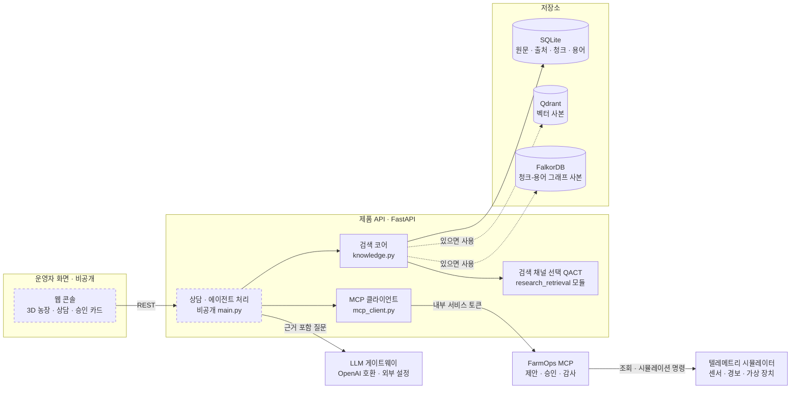
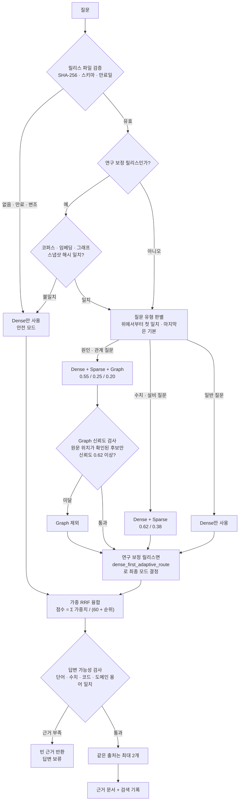
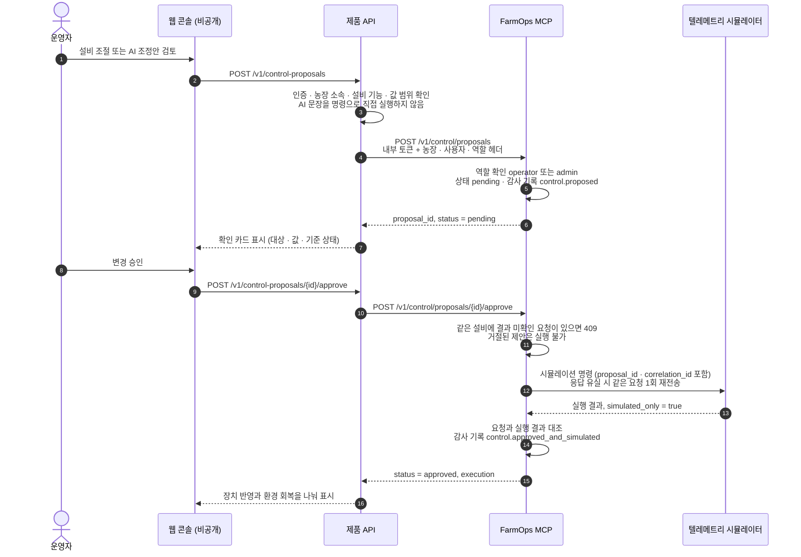

# Smartfarm Adaptive RAG — 질의 적응형 검색 기반 스마트팜 운영 지원 시스템


> **English summary.** Curated public showcase of a private research project on AI operations support for smart greenhouses.
> It contains a retrieval core that picks Dense / Sparse / Graph search channels per question (QACT, published as a first-author KCI paper in 2026), abstains when evidence is weak,
> and an MCP service where device changes run on a simulator only after explicit operator approval.

---

## 한눈에 보기

- **문제**: 스마트팜 운영자의 질문은 "EC 기준값이 얼마인가"처럼 정확한 수치를 찾는 질문과 "근권 온도가 왜 올랐나"처럼 원인을 따라가야 하는 질문이 섞여 있습니다. 한 가지 검색 방식으로는 둘 다 잘 찾기 어렵고, AI가 근거 없이 답하거나 설비를 바로 조작하면 위험합니다.
- **내가 한 일**: 질문 유형에 따라 검색 방식을 고르는 방법(QACT)을 연구해 논문으로 발표했고, 이를 실제 서비스 검색 코어로 구현했습니다. 근거가 부족하면 답하지 않는 장치, 운영자 승인 후에만 설비 값이 바뀌는 제어 서비스, 고추냉이 온실 시뮬레이터까지 혼자 설계·구현했습니다.
- **결과**: KCI 등재 학술지 논문 제1저자 게재(2026). 이 저장소에 포함된 3개 서비스 테스트 249개가 모두 통과합니다. 설정 파일이 없거나 변조되면 가장 단순한 검색 방식으로 자동 후퇴하도록 만들어, 잘못된 설정이 검색 품질을 망치지 않게 했습니다.

## 프로젝트 소개

스마트팜 운영자가 센서 경보, 재배 매뉴얼, 농장 작업 기준(SOP)을 바탕으로 판단할 수 있도록 돕는 AI 운영 지원 시스템의 백엔드입니다. 아래 세 가지 개념만 알면 전체 구조를 이해할 수 있습니다.

| 용어 | 한 문장 설명 |
|---|---|
| **RAG** | AI가 답하기 전에 관련 문서를 먼저 찾아오고, 찾은 문서를 근거로만 답하게 하는 방식입니다. |
| **검색 채널** | 문서를 찾는 방법 하나하나를 말합니다. 뜻이 비슷한 문서(Dense), 같은 단어·수치가 들어간 문서(Sparse), 용어 연결로 이어진 문서(Graph) 세 가지를 씁니다. |
| **승인 흐름** | AI가 설비 조작을 제안하더라도 운영자가 내용을 확인하고 승인해야만 설비 값이 바뀌는 절차입니다. 이 저장소에서는 실제 장비 대신 시뮬레이터에만 반영합니다. |

이 시스템은 다음 원칙으로 동작합니다.

- 질문 유형에 맞는 검색 채널만 켭니다.
- 설정이 없거나 만료·변조되면 Dense 하나만 쓰는 안전 모드로 돌아갑니다.
- Graph 결과는 원문에서 위치가 확인되고 신뢰도 기준을 넘을 때만 씁니다.
- 찾은 문서가 질문과 맞지 않으면 근거를 비워 반환합니다(답변 보류).
- 설비 변경은 `제안 → 운영자 승인 → 시뮬레이터 반영 → 감사 기록` 순서로만 진행합니다.

## 나의 기여

**김유석 ([@NAMUORI00](https://github.com/NAMUORI00))** — 연구와 개발을 단독으로 진행했습니다. 비공개 원본 저장소 기준 2026-07-16 ~ 2026-10-07 동안 커밋 268개를 모두 본인 계정으로 작성했습니다.

| 영역 | 직접 설계·구현한 내용 | 관련 파일 | 결과 |
|---|---|---|---|
| 연구 | 질의 적응형 검색 채널 제어(QACT) 설계, 비교 실험, 논문 작성 | [`research_retrieval_algorithm.py`](services/api/app/research_retrieval_algorithm.py), [`research-algorithm.json`](data/qact-profile/research-algorithm.json) | KCI 논문 제1저자 게재. 연구 코드의 라우팅 함수를 수정 없이 옮기고, 파일 SHA-256을 고정해 변경 여부를 테스트로 확인 |
| 검색 코어 | SQLite 원본 + Qdrant·FalkorDB 사본 구조, 문서 수집·청킹·출처 식별, 3채널 점수와 가중 RRF 융합, Graph 신뢰도 검사, 답변 가능성 검사, 출처 다양성 제한, 검색 기록(trace) | [`knowledge.py`](services/api/app/knowledge.py), [`pdf_extractor.py`](services/api/app/pdf_extractor.py) | 외부 DB가 없어도 SQLite만으로 같은 검색이 동작. 어떤 채널·백엔드를 썼는지 trace에 남음 |
| QACT 릴리스 계약 | 질문 유형·허용 채널·가중치·임계값을 담는 v2 JSON 스키마, 체크섬·만료일·스냅샷 해시 검증, 실패 시 Dense 안전 모드, 보정 릴리스 내보내기 도구 | [`demo-release.json`](data/qact-profile/demo-release.json), [`research_retrieval.py`](services/api/app/research_retrieval.py), [`export_research_qact.py`](tools/export_research_qact.py) | 검증되지 않은 설정이 운영 검색에 들어가지 않음. 개발/검증 데이터 분할이 겹치거나 품질 검증에 실패한 보정 결과는 내보내기 단계에서 거부 |
| 승인형 제어 (FarmOps MCP) | MCP 도구 10개, 제안→승인→시뮬레이션→감사 상태 관리, 역할·내부 토큰·농장 헤더 검사, 같은 설비 중복 요청 차단, 응답 유실 시 1회 재전송과 결과 대조, W3C WoT 형식 장치 프로필 | [`services/farm-mcp/app/`](services/farm-mcp/app), [`mcp_client.py`](services/api/app/mcp_client.py), [`wasabi-greenhouse-v1.json`](data/device-manifests/wasabi-greenhouse-v1.json) | AI 응답이 설비 명령으로 바로 실행되는 경로가 없음. MCP가 응답하지 않으면 승인도 실행되지 않음 |
| 온실 시뮬레이터 | 펄라이트 고설베드 고추냉이 온실 모델, 장치 조작과 센서 변화의 인과 연결, 임계값·센서 상태·작물 위험 경보 구분, 시나리오 10종, 가상 시계, SQLite 상태 저장, 외부 수집 데이터 사전 검증(dry-run) | [`services/telemetry/app/`](services/telemetry/app), [`wasabi-prototype-v1.json`](data/scenarios/wasabi-prototype-v1.json) | 실제 장비 없이 경보 발생 → 조치 제안 → 승인 → 환경 회복 흐름을 재현 |
| 테스트·CI | 서비스별 회귀 테스트, 라우팅 기준 세트(golden suite), GitHub Actions | `services/*/tests/`, [`qact-routing-golden.json`](data/rag-eval/qact-routing-golden.json), [`ci.yml`](.github/workflows/ci.yml) | 249개 테스트 통과 |

**AI 코딩 도구 사용**: 구현 과정에서 Codex와 Claude Code를 페어 프로그래밍 도구로 사용했습니다. 요구사항, 설계 결정, 안전 경계, 검증 기준은 직접 정했고 생성된 코드는 리뷰와 테스트로 확인했습니다.

---

## 시스템 구조

점선 상자는 비공개 저장소에만 있는 구성 요소입니다.



- **SQLite가 원본**이고 Qdrant·FalkorDB는 사본입니다. 사본이 없으면 SQLite에 저장한 벡터와 `chunk_terms` 테이블로 같은 계산을 합니다.
- 임베딩 기본값은 FastEmbed `paraphrase-multilingual-MiniLM-L12-v2`입니다. 모델을 불러오지 못하면 `lexical-hash-v2` 대체 임베딩을 쓰고, 상태 값에 대체 모드임을 표시합니다.

## 핵심 기술

### 1. 질의 적응형 검색 채널 제어 (QACT)

질문 유형에 따라 어떤 검색 채널을 얼마의 비중으로 쓸지 정하는 방식입니다. 설정은 오프라인에서 만든 릴리스 JSON에 담고, 서비스는 이 파일을 검증한 뒤에만 사용합니다.



| 단계 | 구현 내용 | 위치 |
|---|---|---|
| 릴리스 검증 | 파일 SHA-256이 설정값과 같고, 스키마 `smartfarm-qact-release-v2`·만료일·스냅샷 해시 형식이 맞아야 `valid`. 안전 경로는 반드시 Dense 단독이어야 하고, 마지막 질문 유형은 기본 경로여야 함 | `load_qact_release_profile()` |
| 질문 유형 판별 | 릴리스에 적힌 키워드 목록을 위에서부터 비교해 첫 번째로 맞는 유형의 채널·가중치·임계값을 반환 | `QactReleaseProfile.route()` |
| Dense | 질문 벡터와 청크 벡터의 코사인 유사도. Qdrant 우선, 없으면 SQLite 벡터로 계산 | `_qdrant_dense_scores()`, `_local_dense_scores()` |
| Sparse | 질문 토큰이 청크 본문·메타데이터에 얼마나 겹치는지의 비율. BM25는 쓰지 않음 | `_sparse_scores()` |
| Graph | FalkorDB `(Chunk)-[:MENTIONS]->(Term)` 탐색, 없으면 SQLite `chunk_terms`로 대체 | `_graph_scores()` |
| Graph 신뢰도 검사 | 신뢰도 = 0.5 × 출처 검증 비율 + 0.3 × 단어 일치 강도 + 0.2 × Dense 상위 결과와의 일치도. 임계값 미만이면 Graph 제외 | `_graph_scores_with_gate()` |
| 융합 | 채널별 순위에 가중치를 곱한 Reciprocal Rank Fusion, `rrf_k = 60` | `_fuse()` |
| 답변 가능성 검사 | 질문의 수치·코드·도메인 용어·핵심 단어가 근거에 실제로 있는지 규칙으로 확인. 통과 못 하면 근거를 비움 | `_answerability()` |
| 출처 다양성 | 같은 출처에서 최대 2개 청크만 반환 | `_diverse_ranked()` |

연구 코드에서 옮긴 `dense_first_adaptive_route()`는 정규화된 Graph 가중치가 0.35를 넘고 검증된 Graph 근거가 있을 때만 3채널 융합을 고릅니다. 그 외에는 Graph를 끄고, 보정하지 않은 균등 가중치(0.34/0.33/0.33, 허용 오차 0.02)면 Dense 단독, Sparse 가중치가 0.40 이상이면 Dense+Sparse, 나머지는 Dense 단독으로 갑니다. 파일 바이트(CRLF 포함)의 SHA-256을 [`research-algorithm.json`](data/qact-profile/research-algorithm.json)에 고정했고, [`.gitattributes`](.gitattributes)로 줄바꿈 변환을 막았습니다.

> [!NOTE]
> [`demo-release.json`](data/qact-profile/demo-release.json)은 회귀 테스트용 데모 릴리스입니다. 질문 유형 키워드와 가중치는 현장에서 검증한 값이 아니며, 논문의 성능 수치를 재현하지 않습니다.

### 2. 승인형 설비 제어 흐름

[`services/farm-mcp`](services/farm-mcp)의 `FarmOperationsService`와 [`mcp_client.py`](services/api/app/mcp_client.py)가 이 흐름을 구현합니다. 웹 콘솔과 제품 API 엔드포인트(`/v1/control-proposals`)는 비공개 원본 기준으로 그렸습니다.



- MCP 도구는 조회 7개(`get_farm_snapshot`, `get_sensor_timeseries`, `list_alerts`, `list_farm_devices`, `get_device_capabilities`, `preview_control_impact`, `track_recent_executions`)와 변경 3개(`propose_control_action`, `approve_control_proposal`, `reject_control_proposal`)입니다. 도구 입력에는 `farm_id`가 없고, 농장 정보는 신뢰된 헤더로만 받습니다.
- 장치 연결부는 `DeviceCommandAdapter` 인터페이스(`describe_capabilities → read_snapshot → request_command → read_command_status → confirm_outcome`)로 분리했습니다. 현재 구현은 시뮬레이터 어댑터 하나입니다.

## 연구 성과

| 항목 | 내용 |
|---|---|
| 논문 | 「스마트팜 RAG를 위한 질의 적응형 검색 채널 제어」, *한국정보기술학회논문지*, 제24권 제6호, pp. 99–108, 2026 (KCI 등재) |
| 역할 | **제1저자** — 방법 설계, 실험, 원고 작성 |
| DOI | [10.14801/jkiit.2026.24.6.99](https://doi.org/10.14801/jkiit.2026.24.6.99) |
| 저장소와의 관계 | 논문의 채널 제어를 운영 검색 경로에 연결했습니다. 운영 쪽에는 체크섬 고정 릴리스, 스냅샷 해시 검증, Graph 신뢰도 검사, Dense 안전 모드를 추가했습니다. 실험 코드·데이터·결과표는 비공개 연구 저장소에 있습니다. |

## 기술 스택

| 영역 | 기술 |
|---|---|
| 언어·프레임워크 | Python 3.12, FastAPI, Pydantic v2, Uvicorn |
| 검색·저장 | SQLite, Qdrant(REST), FalkorDB(Cypher), FastEmbed, 연구 환경용 sentence-transformers(선택) |
| 도구 연동 | MCP 호환 JSON-RPC(`initialize`, `tools/list`, `tools/call`) + REST |
| 문서 처리 | pypdf, BeautifulSoup, lxml, Pillow |
| 실행·검증 | Docker Compose, pytest, httpx, GitHub Actions |

## 실행 방법

```bash
git clone https://github.com/NAMUORI00/smartfarm-adaptive-rag.git
cd smartfarm-adaptive-rag
```

### 검색 코어 직접 호출 (외부 서비스 불필요)

`services/api`에서 실행합니다. Qdrant·FalkorDB 없이 SQLite 경로로 동작하고, `hash` 임베딩을 쓰므로 모델을 내려받지 않습니다.

```python
from hashlib import sha256
from pathlib import Path
from app.knowledge import KnowledgeStore, EmbeddingRuntime, load_qact_release_profile

release = Path("../../data/qact-profile/demo-release.json")
profile = load_qact_release_profile(str(release), sha256(release.read_bytes()).hexdigest())
question = "근권 온도가 상승한 원인과 산소 공급의 관계는?"
route = profile.route(question)  # causal_relationship → dense + sparse + graph

store = KnowledgeStore(":memory:", embedding_runtime=EmbeddingRuntime(provider="hash"))
store.seed_defaults()  # data/demo-corpus 문서 6개
res = store.retrieve(
    query=question, farm_id="farm-wasabi-a", include_private=True, selected_document_ids=None,
    retrieval_path=route["retrieval_path"], channel_weights=route["channel_weights"],
    graph_reliability_threshold=route["graph_reliability_threshold"],
)
print(res.trace["fusion"], res.trace["graph_gate"]["reason"], res.trace["answerable"])
for hit in res.hits:
    print(hit.score, hit.channels, hit.title)
```

체크섬을 틀리게 넣으면(`load_qact_release_profile(str(release), "0" * 64)`) `route()`가 `["dense"]`만 반환합니다.

### MCP + 시뮬레이터 실행 (Docker Compose)

```bash
cp .env.example .env      # 로컬 전용 토큰 값을 바꿔서 사용
docker compose up --build # telemetry: 127.0.0.1:8120, farm-mcp: 127.0.0.1:8110
```

```bash
set -a && . ./.env && set +a   # MCP_SERVICE_TOKEN 불러오기
H=(-H "X-Internal-Service-Token: $MCP_SERVICE_TOKEN" -H "X-Farm-Id: farm-wasabi-a" \
   -H "X-Actor-Id: operator-01" -H "X-Actor-Role: operator")

# 제안 생성 → 승인(시뮬레이터 반영) → 감사 기록 조회
curl -X POST http://127.0.0.1:8110/v1/control/proposals "${H[@]}" -H "Content-Type: application/json" \
  -d '{"action":"set_circulation_fan_percent","target_value":60,"zone_id":"zone-a","rationale":"humidity rising"}'
curl -X POST http://127.0.0.1:8110/v1/control/proposals/<proposal_id>/approve "${H[@]}"
curl http://127.0.0.1:8110/v1/audit/events "${H[@]}"
```

토큰이 없으면 401, `viewer` 역할로 제안하면 403입니다. 도구 목록은 `POST /mcp`에 `{"jsonrpc":"2.0","id":1,"method":"tools/list"}`로 확인할 수 있습니다.

## 테스트

```bash
cd services/api       && pip install -r requirements-dev.txt && python -m pytest -q
cd ../farm-mcp        && pip install -r requirements-dev.txt && python -m pytest -q
cd ../telemetry       && pip install -r requirements-dev.txt && python -m pytest -q
```

| 서비스 | 테스트 수 | 주요 검증 내용 |
|---|---|---|
| `services/api` | 101 | 릴리스 검증·만료·변조 시 Dense 안전 모드, 라우팅 golden suite, 연구 알고리즘 경계값·해시 무결성, Graph 신뢰도 검사, 답변 보류, 재색인, MCP 클라이언트 |
| `services/farm-mcp` | 46 | 제안·승인·거절 상태 전이, 역할·토큰 검사, 감사 기록, 장치 어댑터, JSON-RPC 도구 |
| `services/telemetry` | 102 | 장치 조작에 따른 센서 변화, 경보 발생·해제, 상태 저장, 다운샘플링, 수집 데이터 검증 |

- 2026-10-09 로컬(Windows, Python 3.13)에서 249개 모두 통과했습니다. CI는 Python 3.12에서 세 서비스를 각각 실행합니다.
- 테스트는 소프트웨어 회귀 검증입니다. 현장 검색 품질이나 물리 장치 안전성을 검증한 결과는 아닙니다.

## 디렉터리 구조

```text
smartfarm-adaptive-rag/
├── services/
│   ├── api/                  # 제품 API 중 검색 코어만 발췌 (main.py 제외)
│   │   ├── app/
│   │   │   ├── knowledge.py                    # 문서 저장·QACT 로딩·3채널 검색·융합·답변 보류
│   │   │   ├── research_retrieval_algorithm.py # 연구 라우팅 함수 (해시 고정, CRLF 유지)
│   │   │   ├── research_retrieval.py           # 연구 정책 검증, 스냅샷 해시, 릴리스 내보내기
│   │   │   ├── mcp_client.py                   # 제품 API → FarmOps MCP 클라이언트
│   │   │   └── research_embedding.py · agent_state.py · pdf_extractor.py
│   │   └── tests/
│   ├── farm-mcp/             # 승인형 제어 MCP 서비스
│   └── telemetry/            # 고추냉이 온실 텔레메트리 시뮬레이터
├── data/
│   ├── qact-profile/         # demo-release.json, research-algorithm.json
│   ├── rag-eval/             # QACT 라우팅 golden suite
│   ├── demo-corpus/          # 공개 자료를 요약한 데모 문서 6개 (출처 링크 포함)
│   ├── device-manifests/     # WoT 형식 장치 프로필
│   └── crop-profiles/ · scenarios/ · telemetry-adapters/
├── tools/export_research_qact.py
├── compose.yaml              # telemetry + farm-mcp 실행
└── .env.example
```

## TODO / 향후 작업

- [ ] 보정 릴리스 품질 기준 재검증 (실제 농장 코퍼스의 개발/검증 분할 기준, 통과 전까지 Dense 안전 모드 유지)
- [ ] 키워드 기반 질문 유형 판별을 평가 데이터 기반 분류로 개선
- [ ] Sparse 채널을 BM25 또는 한국어 형태소 분석 기반 검색으로 교체
- [ ] Graph 채널을 청크-용어 공출현에서 엔터티·관계 추출 기반 지식 그래프로 확장
- [ ] `TelemetryIngressRequest`, `DeviceCommandAdapter`에 MQTT·Modbus·OPC UA 어댑터 연결
- [ ] 내부 토큰·신뢰 헤더 방식을 사용자 인증, 비밀 관리, 테넌트 격리 검증으로 강화

## 공개 범위 안내

- 비공개 연구 저장소에서 **직접 작성한 핵심 코드만 골라 정리한 공개용 쇼케이스**입니다. 커밋 이력은 원본 개발 이력이 아닙니다.
- 웹 콘솔(TypeScript·React·Three.js), 제품 API의 상담·에이전트 처리(`main.py`), 영상 연구, 학위논문 원고, 실험 산출물은 포함하지 않았습니다. 따라서 이 저장소만으로 전체 제품을 실행할 수는 없습니다.
- 모든 센서와 설비는 시뮬레이터입니다. 실제 장비에는 연결하지 않습니다.
- 라이선스: 별도 라이선스 없음 (열람 목적 공개)

- 문의: GitHub [@NAMUORI00](https://github.com/NAMUORI00)
