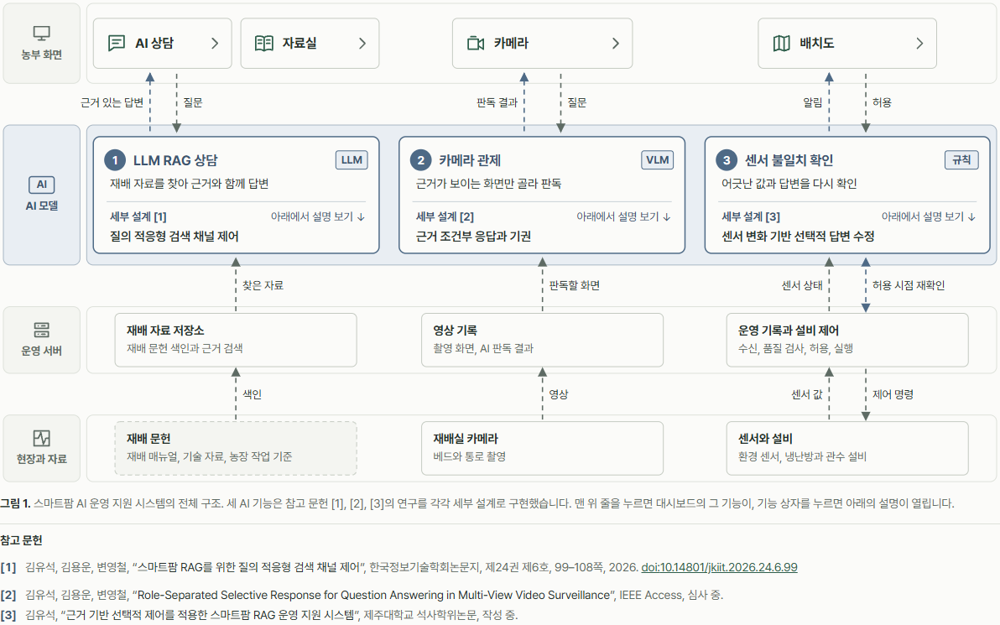
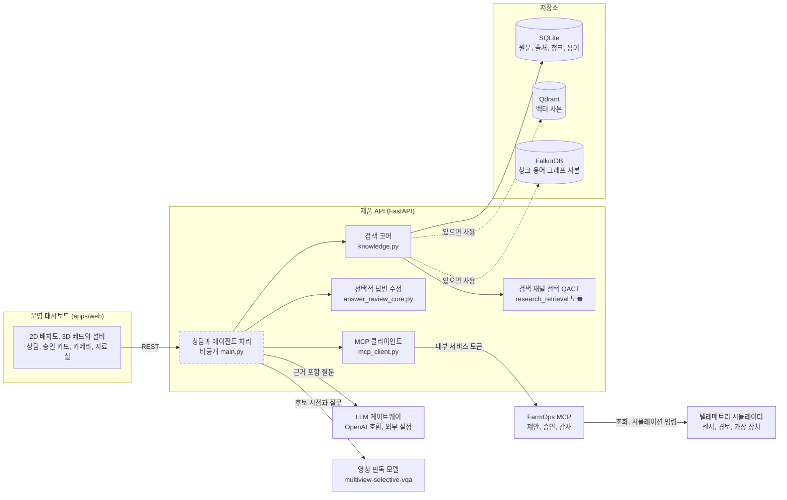
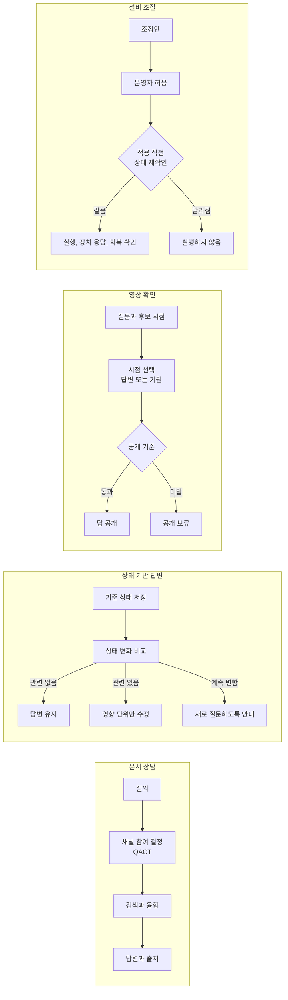
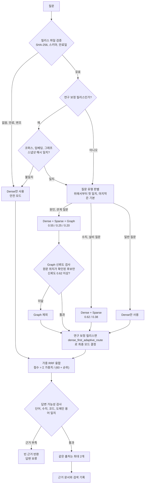
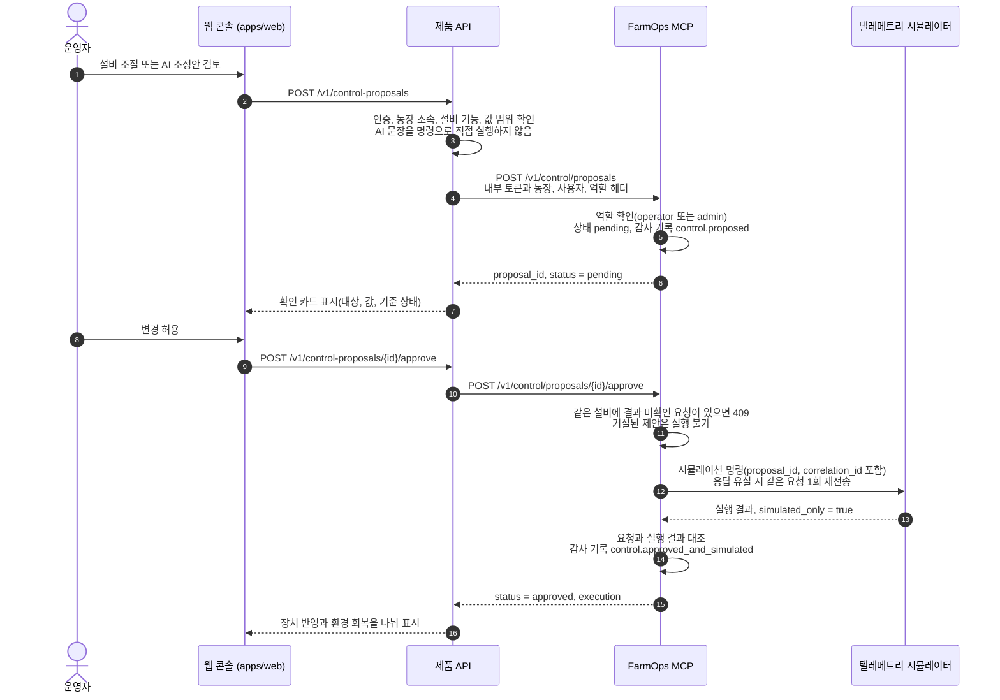
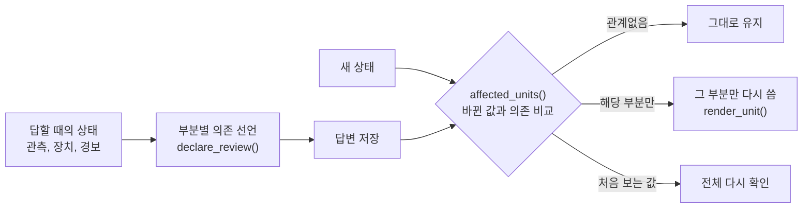
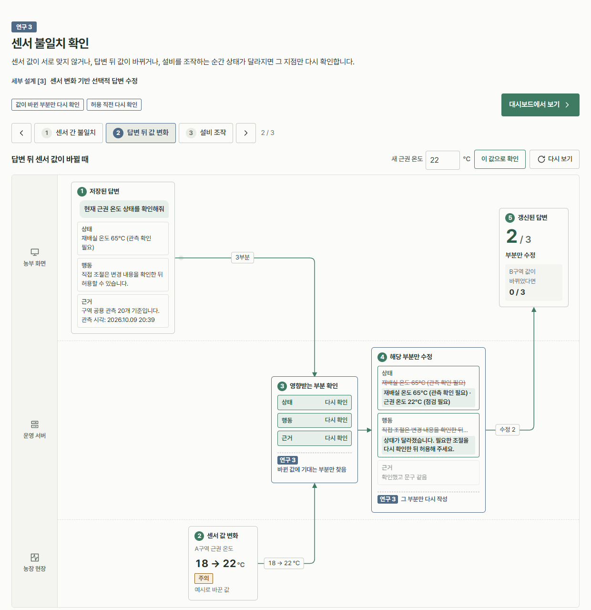
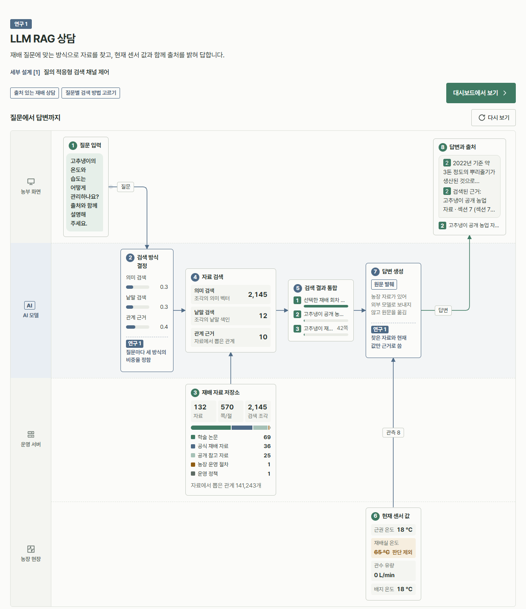

# 구조와 구현 상세

[README로 돌아가기](../README.md)

README의 도식을 구현 수준에서 설명합니다. 함수와 파일 이름, 상수, API 흐름을 여기에 모았습니다.

## 시스템 구조

세 AI 기능은 같은 운영 서버와 현장 데이터를 쓰지만 근거를 가져오는 곳이 다릅니다. 상담은 재배 자료 저장소에서, 카메라 관제는 영상 기록에서, 센서 불일치 확인은 운영 기록과 설비 제어에서 근거를 가져옵니다.

아래 그림의 점선 상자(상담과 에이전트 처리)는 비공개 저장소에만 있습니다.

- 원본 데이터는 SQLite에 두고 Qdrant와 FalkorDB는 사본으로 씁니다. 사본이 없으면 SQLite에 저장한 벡터와 `chunk_terms` 테이블로 같은 계산을 합니다.
- 임베딩 기본값은 FastEmbed `paraphrase-multilingual-MiniLM-L12-v2`입니다. 모델을 불러오지 못하면 `lexical-hash-v2` 대체 임베딩으로 바꾸고, 상태 값에 대체 모드라고 남깁니다.
- 농장 전용 자료가 섞인 질문은 외부 LLM에 보내지 않고 로컬에서 요약해 답합니다.

### 업무별 처리 흐름

업무는 같은 구역과 베드를 기준으로 연결되지만, 문서 검색, 영상 판독, 상태 재검토는 그 업무에서만 실행합니다.

## 핵심 기술 상세

### 1. 질의 적응형 검색 채널 제어 (QACT)

질문 유형에 따라 어떤 검색 채널을 어느 비중으로 쓸지 정합니다. 설정은 오프라인에서 만든 릴리스 JSON에 담고, 서비스는 이 파일을 검증한 다음에만 씁니다.

| 단계 | 구현 내용 | 위치 |
|---|---|---|
| 릴리스 검증 | 파일 SHA-256이 설정값과 같고 스키마 `smartfarm-qact-release-v2`, 만료일, 스냅샷 해시 형식이 맞아야 `valid`입니다. 안전 경로는 Dense 단독이어야 하고 마지막 질문 유형은 기본 경로여야 합니다. | `load_qact_release_profile()` |
| 질문 유형 판별 | 릴리스에 적힌 키워드 목록을 위에서부터 비교해 처음 맞는 유형의 채널, 가중치, 임계값을 돌려줍니다. | `QactReleaseProfile.route()` |
| Dense | 질문 벡터와 청크 벡터의 코사인 유사도입니다. Qdrant가 있으면 먼저 쓰고, 없으면 SQLite 벡터로 계산합니다. | `_qdrant_dense_scores()`, `_local_dense_scores()` |
| Sparse | 질문 토큰이 청크 본문과 메타데이터에 겹치는 비율입니다. BM25는 쓰지 않습니다. | `_sparse_scores()` |
| Graph | FalkorDB에서 `(Chunk)-[:MENTIONS]->(Term)`을 탐색하고, 없으면 SQLite `chunk_terms`로 대신합니다. | `_graph_scores()` |
| Graph 신뢰도 검사 | 신뢰도 = 0.5 × 출처 검증 비율 + 0.3 × 단어 일치 강도 + 0.2 × Dense 상위 결과와의 일치도. 임계값보다 낮으면 Graph를 뺍니다. | `_graph_scores_with_gate()` |
| 융합 | 채널별 순위에 가중치를 곱한 Reciprocal Rank Fusion(`rrf_k = 60`)입니다. | `_fuse()` |
| 답변 가능성 검사 | 질문의 수치, 코드, 도메인 용어, 주요 단어가 근거에 실제로 있는지 규칙으로 확인하고, 통과하지 못하면 근거를 비웁니다. | `_answerability()` |
| 출처 다양성 | 같은 출처에서는 청크를 최대 2개만 돌려줍니다. | `_diverse_ranked()` |

연구 코드에서 옮긴 `dense_first_adaptive_route()`는 정규화된 Graph 가중치가 0.35를 넘고 검증된 Graph 근거가 있을 때만 3채널 융합을 고릅니다. 그렇지 않으면 Graph를 끄고, 보정하지 않은 균등 가중치(0.34/0.33/0.33, 허용 오차 0.02)일 때는 Dense 단독, Sparse 가중치가 0.40 이상일 때는 Dense+Sparse, 나머지는 Dense 단독으로 갑니다. 파일 바이트(CRLF 포함)의 SHA-256을 [`research-algorithm.json`](../data/qact-profile/research-algorithm.json)에 고정했고, [`.gitattributes`](../.gitattributes)로 줄바꿈 변환을 막았습니다.

> [!NOTE]
> [`demo-release.json`](../data/qact-profile/demo-release.json)은 회귀 테스트용 데모 릴리스입니다. 질문 유형 키워드와 가중치는 현장에서 검증한 값이 아니며, 논문의 성능 수치를 재현하지 않습니다.

### 2. 승인형 설비 제어 흐름

[`services/farm-mcp`](../services/farm-mcp)의 `FarmOperationsService`와 [`mcp_client.py`](../services/api/app/mcp_client.py)가 이 흐름을 구현합니다. 웹 콘솔은 [`apps/web`](../apps/web)의 설비 조절 카드이고, 제품 API 엔드포인트(`/v1/control-proposals`)는 비공개 원본을 기준으로 그렸습니다.

- MCP 도구는 조회용 7개(`get_farm_snapshot`, `get_sensor_timeseries`, `list_alerts`, `list_farm_devices`, `get_device_capabilities`, `preview_control_impact`, `track_recent_executions`)와 변경용 3개(`propose_control_action`, `approve_control_proposal`, `reject_control_proposal`)입니다. 도구 입력에는 `farm_id`가 없고, 농장 정보는 신뢰된 헤더로만 받습니다.
- 장치 연결부는 `DeviceCommandAdapter` 인터페이스(`describe_capabilities`, `read_snapshot`, `request_command`, `read_command_status`, `confirm_outcome`)로 분리했습니다. 지금 구현된 어댑터는 시뮬레이터 하나입니다.

### 3. 센서 변화 기반 선택적 답변 수정

상담한 뒤 센서 값이 바뀌면 예전 답을 믿고 설비를 움직이는 실수가 생길 수 있습니다. [`answer_review_core.py`](../services/api/app/answer_review_core.py)는 답을 상태 설명, 행동 안내, 관측 근거의 세 부분으로 나누고, 답을 만들기 전에 각 부분이 기대는 관측을 선언해 둡니다. 나중에 상태가 바뀌면 바뀐 값에 기대는 부분만 다시 씁니다. 생성된 문장을 읽어 판단하지는 않습니다.

이 저장소에는 그 규칙을 상담 답변에 붙인 제품 쪽 코드가 있습니다. 실행 직전 재확인 엔진, 비교 조건(B0, B1, B2, SR), 사전에 고정한 시나리오와 평가 산출물은 [smartfarm-state-revalidation](https://github.com/NAMUORI00/smartfarm-state-revalidation)에 있습니다.

- 현재 상태를 묻는 질문은 정상 범위 안의 작은 흔들림을 무시하고 범위 이탈, 품질 이상, 5분이 지난 관측, 장치와 경보 변화만 비교합니다. 재배 지식을 묻는 질문은 센서 값의 흔들림을 따라가지 않습니다.
- 다른 구역의 변화는 답에 영향을 주지 않습니다(그림의 "B구역 값이 바뀌었다면 0/3"). 한 번 고친 뒤에도 값이 계속 바뀌면 고쳐 쓰지 않고 새로 질문하도록 안내합니다.
- 테스트는 [`test_answer_review_core.py`](../services/api/tests/test_answer_review_core.py)에 있습니다. 이 코드는 제품에 쓰는 구조화 규칙이고, 자유 형식 LLM 문장을 부분 수정하는 성능을 검증한 것은 아닙니다.

### 4. 운영 대시보드

[`apps/web`](../apps/web)은 React 19, TypeScript, Three.js, Vite로 만들었습니다.

| 구성 | 위치 | 내용 |
|---|---|---|
| 농부 화면 | [`FarmerWorkspace.tsx`](../apps/web/src/farmer/FarmerWorkspace.tsx) | 배치도, 오른쪽 패널, 상담 창, 카메라, 자료실을 한 화면 흐름으로 연결 |
| 2D 배치도 | [`FarmPlan.tsx`](../apps/web/src/farmer/FarmPlan.tsx) | SVG 온실 평면, 설비 상태와 배관 흐름, AI 우선순위 표시 |
| 3D 모형 | [`FarmMap.tsx`](../apps/web/src/farmer/FarmMap.tsx), [`farm-models.ts`](../apps/web/src/farmer/farm-models.ts) | glTF 온실 모형(베드 18개 × 4단)과 코드로 만든 설비 모형. 장치 보고값에 따라 움직임 |
| AI 브리핑 | [`ai-brief.ts`](../apps/web/src/farmer/ai-brief.ts) | 경보, 센서 교차 확인, 설비 보고, 카메라 기록, 재배 일정을 묶어 먼저 볼 곳의 순위를 정함 |
| 기록 재생 | [`replay.ts`](../apps/web/src/demo/replay.ts) | `VITE_DEMO_STATIC=1`로 빌드하면 API 요청을 모두 기록으로 답함. 기록 시각은 지금으로 옮기고 실시간 값은 10분 기록을 반복 |

데모 기록과 GitHub Pages 배포는 [`demo`](https://github.com/NAMUORI00/smartfarm-adaptive-rag/tree/demo) 브랜치에 있습니다. 기록할 때 실제로 물어본 추천 질문과 카메라 판독, 연구 흐름 실행만 답이 나오고, 그 밖의 질문에는 기록에 없다는 안내가 나옵니다. 설비 조절과 카메라 확인 기록 닫기는 그 브라우저 안에서만 반영됩니다.

